# EpiLag-PH

**Dengue warning weeks before the wards fill up.** EpiLag-PH forecasts dengue cases 2–8 weeks ahead for
Philippine provinces, regions and Quezon City. It says which areas are heading for an outbreak, what the local
health office should do this week, and where a limited budget prevents the most cases.

Entry by **Team DiagNodes** for the Philippine Junior Data Science Challenge (PJDSC) 2026,
*Trace the Pattern, Target the Cure: Advancing Public Health Through Data Science.*

| [Website](https://romeo-04.github.io/epilag/) | [Live app](https://romeo-04.github.io/epilag/web/) | [Dengue Drill](https://romeo-04.github.io/epilag/drill/) | [Demo video (2:50)](docs/demo.mp4) | [Slides (PDF)](docs/deck/EpiLag-PH_deck.pdf) | [Methodology](https://romeo-04.github.io/epilag/methodology.html) | [Trust and sustainability](https://romeo-04.github.io/epilag/trust.html) | [Open data](https://romeo-04.github.io/epilag/data/) |
| --- | --- | --- | --- | --- | --- | --- | --- |

Everything runs in your browser, with no install or account: the app is ready in about 3 seconds, and the maps and
the game are drawn as 3D pixel art.

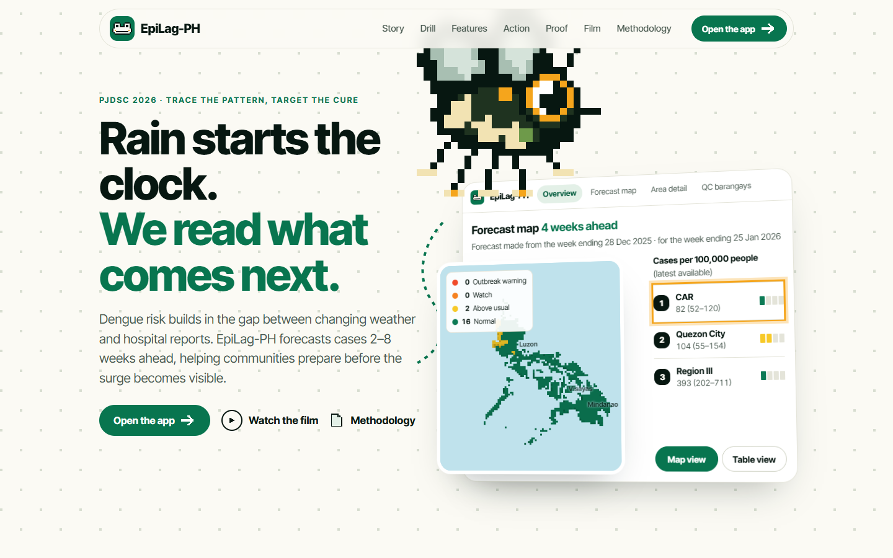

## Contents
- **Overview:** [Watch the demo](#watch-the-demo) · [In one minute](#in-one-minute) · [Play it: Dengue Drill](#play-it-dengue-drill) · [How it works](#how-it-works) · [Who it is for](#who-it-is-for) · [What you can do](#what-you-can-do)
- **Evidence:** [Does it work?](#does-it-work) · [Method](#method) · [Data](#data) · [Deployment and sustainability](#deployment-and-sustainability) · [Limits](#limits)
- **For developers:** [Run it](#run-it) · [Documentation](#documentation) · [Repository](#repository) · [References](#references)

## Watch the demo
[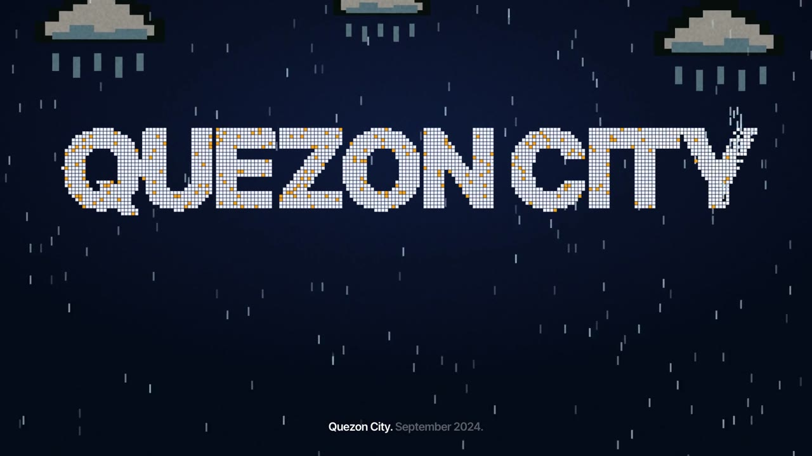](docs/demo.mp4)

**[▶ Watch the demo video (2:50, MP4)](docs/demo.mp4)**, also on the [website](https://romeo-04.github.io/epilag/#film).
It opens in Quezon City in September 2024, as the rains arrive and the city's weekly dengue report still looks quiet.
The outbreak that followed stayed above the epidemic line for 27 weeks and peaked at 622 cases a week in February 2025,
and the clean-up drives and fogging came only after the wards were full. The video then rewinds to September and
replays the forecasts EpiLag-PH would have made at the time, tours the app (forecast map, priority list, what to do
in each area, and the budget plan), explains the model and the 2019 replay, states the limits, and ends with
Dengue Drill.

## In one minute
- **Problem:** dengue response usually starts after hospital admissions are already high. Cases are reported after
  people get sick, so clean-up drives and fogging often arrive after the peak. The Philippines reported about
  442,000 cases in 2019 (DOH via HDX), and true infections are several times higher.
- **Insight:** an outbreak gives early signs. Cases start rising above the usual level for the season, and rain fills
  breeding sites weeks before mosquitoes multiply. That lag is time a health office can use.
- **Solution:** EpiLag-PH turns those signs into a forecast with a likely range, an alert level, a week-by-week
  checklist, a budget plan and a plain-language message for residents.
- **Proof, latest data:** Quezon City's 2024–25 outbreak stayed above its epidemic line for 27 weeks and peaked at
  622 cases a week (five times the line) in February 2025. EpiLag-PH's out-of-sample forecasts flagged it **5 weeks
  before it crossed the line**, and kept it flagged every week to the peak.
- **Proof, nationwide:** in a replay of 2019 using only data available on 2 June, **30 of the 32 provinces** that
  later crossed the epidemic threshold were flagged 4 weeks ahead.

## Play it: Dengue Drill
**[▶ Play Dengue Drill in your browser](https://romeo-04.github.io/epilag/drill/)**. No install needed.

Forecasts are easy to ignore until you feel what they are worth. Dengue Drill makes you the health officer for one area
during a real outbreak. The first mission is the latest: **Quezon City's 2024–25 season, barangay by barangay** (142
barangays). The other 17 missions are the regions during the 2019 outbreak, the year the Philippines declared a
national dengue epidemic.

Your area is a 3D pixel island: each province or barangay rises higher and redder as its cases pass its epidemic line,
rain falls as heavily as it did that week (storms bring lightning), mosquitoes swarm after the rain, and outbreaks glow.
Drag to turn the island, scroll or pinch to zoom.

Quezon City reports weekly cases only for the whole city, so the mission's barangay numbers are estimates, and the game
says so: each barangay gets the city's weekly cases times its share of the city's 2025 cases, and the EpiLag-PH intel is
the real city forecast made that week, shared out the same way. There is no city rain series, so that mission has no
rain.

You play each season twice: round 1 starts straight away with case reports only. After it, you choose a forecaster
and replay the same season in round 2 with its 4-week forecasts: EpiLag-PH's submitted model, one of the research's three other methods (negative binomial, random forest,
SARIMAX), or the average of the four. The debrief shows how a computer player on each model's alerts would have done, and
you can replay round 2 with another model. The average is approximate: it is computed from the four models' rounded
forecasts (`scripts/drill_models.py`).

| | |
| --- | --- |
| 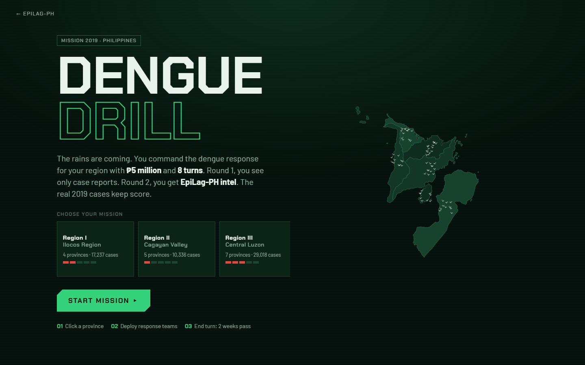 | 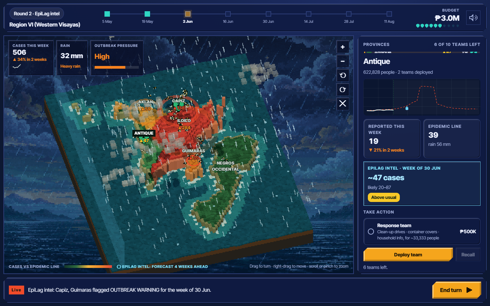 |

1. **Pick a mission.** You get ₱5 million in response teams and 8 turns (from November 2024 in Quezon City, May 2019
   in the regions). Each turn is 2 weeks.
2. **Read the receipt.** Before you start, a receipt lists the season's cases (and, for the regions, its rain), area by area.
3. **Round 1: react.** You see only case reports, just as most health offices do today. Deploy teams to provinces, then end the turn.
4. **Choose a forecaster.** EpiLag-PH or one of the other models, each trained only on earlier years.
5. **Round 2: forecast.** Same region, same budget, now with that model's alerts and forecast ranges on the map.
6. **Get scored on real data.** Each team prevents a share of the cases reported 2–9 weeks after it is deployed. After
   each round you get a mission report and a grade based on the real cases. At the end, your two rounds are
   compared with two computer players: one that reacts to reports and one that follows EpiLag-PH.

In test runs of the 2019 missions, the computer player that follows EpiLag-PH's alerts averted more cases than the one
reacting to reports in **11 of 17 regions** (about the same in 1, fewer in 5). The game shows this result honestly, including the regions where
early action did not pay off.

## How it works
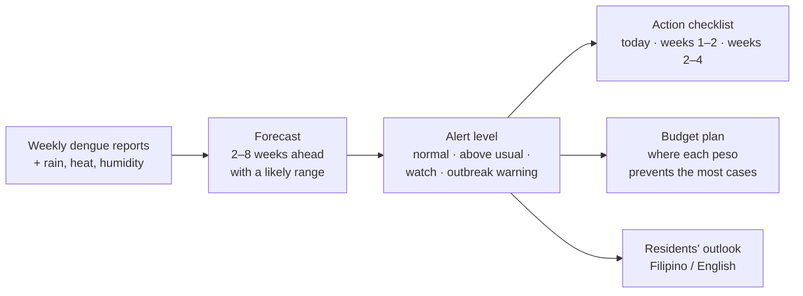

1. **Forecast.** A model trained on past outbreaks estimates next weeks' reported cases for each area, with a
   low–middle–high range.
2. **Alert.** Each forecast is compared with that area's normal level for the same week in earlier years.
   *Watch* means an outbreak is possible. *Outbreak warning* means one is likely.
3. **Act.** Every alert comes with what to do, when to do it, and what EpiLag-PH contributes to each step.
   Each action has a trigger from DOH and Quezon City practice (for example, spraying only where the DOH clustering
   rule is met). The checklist can be downloaded as a one-page action brief.
4. **Allocate.** Given a budget, EpiLag-PH ranks where clean-up drives and fogging avert the most forecast cases
   per peso, with cautious low/central/high estimates.

## Who it is for
| User | What they get |
| --- | --- |
| **Provincial, city and municipal health offices** | Alert map, area checklists, a *When to act* table of triggers, action brief, budget plan, and an explanation of why each area is flagged |
| **Barangays and residents** | A *For residents* page with this week's outlook, the DOH 4S steps, warning signs, a message ready to share in a group chat, and a one-SMS version for phones without data |
| **Trainees, students and the public** | [Dengue Drill](https://romeo-04.github.io/epilag/drill/), a game where you run the response yourself, from Quezon City's barangays in 2024–25 to the 2019 regions |
| **Researchers, newsrooms and other apps** | Every forecast and each area's alert track record as [CSV and JSON](https://romeo-04.github.io/epilag/data/), with column definitions, plus [RSS](https://romeo-04.github.io/epilag/data/alerts.xml) and [calendar](https://romeo-04.github.io/epilag/data/alerts.ics) alert feeds |

## What you can do
**Overview: see this week's priorities.** The app opens on a dashboard: how many areas need action now, a 3D map of
the forecast, the priority list, *Rising toward an outbreak*, and this week's action brief. *Rising toward an
outbreak* places each forecast on its own area's scale: 0% is usual for that week of the year, 100% is the area's
outbreak line (mean + 2 SD). This cancels out population, how endemic an area is, season and reporting
completeness, so a big city is not ranked first just for being big. Each row shows the move from the latest week to
the forecast on a small meter. The priority list sorts by cases or by *reliability*
(areas on alert first, then by how often their past alerts were right). The sidebar groups the tools into *Monitor*,
*Act* and *Evidence*; explanations sit behind "About this" buttons, in English and Filipino.

**Pick the area, from latest to most specific.** The settings bar has two dropdowns. *Region* is All Philippines or one
of 17 regions (the latest data, to December 2025). *Province / city* then lists only that region: the whole region,
Quezon City under NCR (also to December 2025), and the region's provinces, marked as data to January 2021 and opened
as a historical replay limited to that region's provinces.

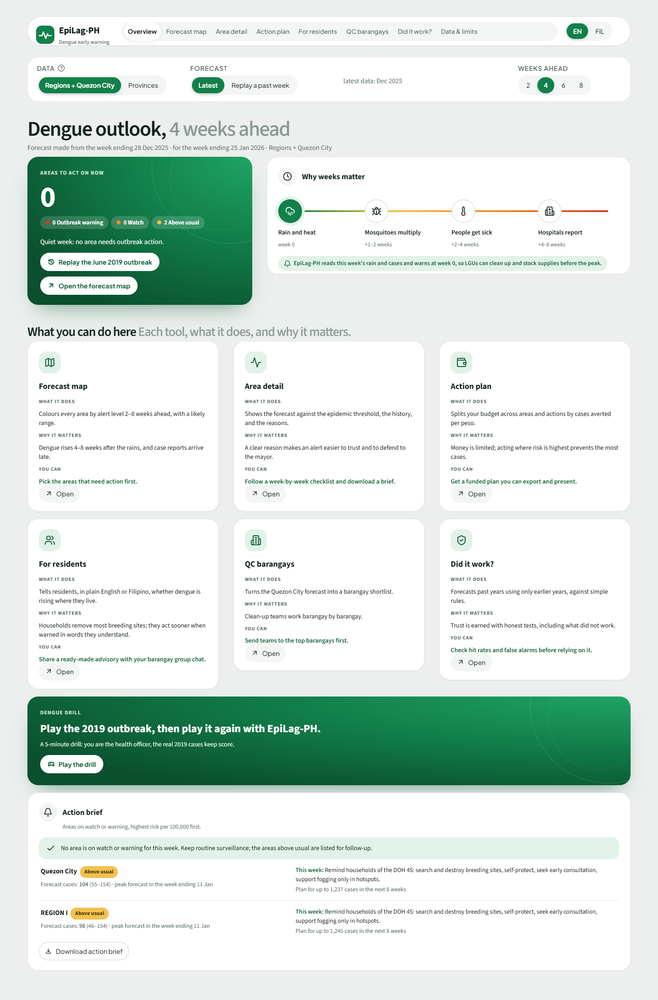

**Forecast map: where to act first.** Columns rise with the alert level; hover for the numbers, click to open an area.
Click a level count (normal, above usual, watch, outbreak warning) to open a panel listing the areas at that level,
closest to their own outbreak line first; click one to fly the map there. A line under the counts says what they
count (for example 17 regions and Quezon City, 8 weeks ahead). In replay mode the map shows what happened next.

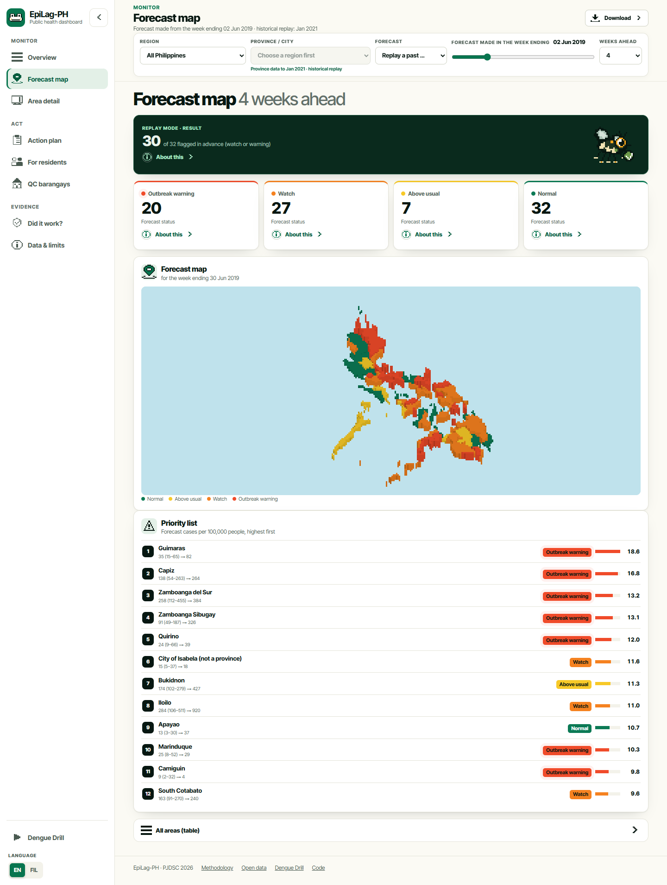

**Area page: know what to do and why.** Each area shows its forecast range, alert level, checklist, and the
factors behind the forecast (recent cases, season, rain, heat, humidity).

- **Alert track record:** how far to trust this area's alert. From the out-of-sample tests: the share of its past
  watch and warning weeks when cases really went above the epidemic line, and how many outbreak starts were flagged
  in time (for example, Quezon City at 4 weeks ahead: 41 of 84 alert weeks right, 5 of 7 outbreak starts caught).
  A replay counts only the test years before it, so a 2019 replay has no track record yet.
- **Report card:** the last 8 weeks with results, each a square showing whether the reported cases landed inside,
  above or below the forecast's likely range. *Did it work?* has the same report card for every area.
- **Print:** *Download → Print area report* gives a one-page A4 report (alert, checklist, track record, chart)
  for meetings and offices without screens.

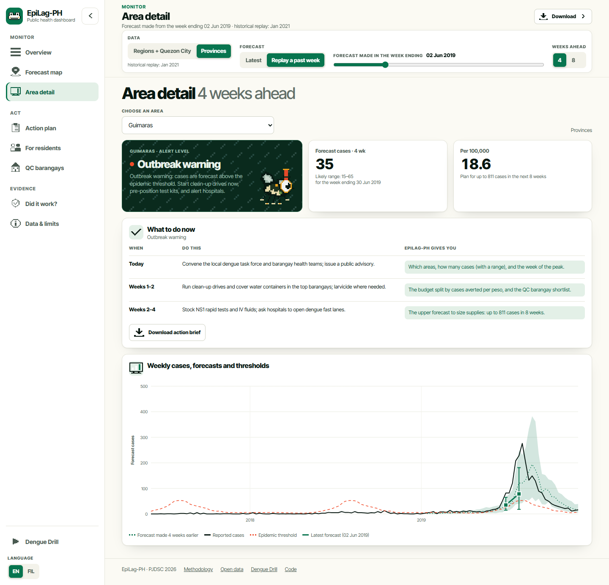

**Action plan: when to act and where to spend.** A *When to act* card lists each action, the alert level it starts
at, what triggers it, and where the current forecast says to start it now (the areas at that level or higher,
worst first, or *Not yet*):

| Starts at | Action | When |
| --- | --- | --- |
| Normal | Search and destroy | Every week at 4 p.m. in every barangay, even in quiet weeks |
| Above usual | 4S reminder to households | When cases trend above the usual level |
| Watch | Larviciding | Water that cannot be drained or covered (canals, ponds, tanks) in the top barangays |
| Watch | Test kits, IV fluids and spraying teams | Check stocks and get teams ready to start within days |
| Watch | Cluster spraying (fogging) | Only in a barangay with 3+ cases in 4 consecutive weeks (DOH clustering), or cases rising 2 weeks in a row |
| Outbreak warning | Task force and public advisory | As soon as the middle forecast passes the epidemic threshold |
| Outbreak warning | Hospital fast lanes | NS1 rapid tests, IV fluids and dengue fast lanes within 2–4 weeks |

Sources: DOH 4S strategy and 4 o'clock habit, the DOH clustering definition, and Quezon City's 2022 and 2025 dengue
responses. The same triggers appear in each area's checklist, in English and Filipino. Below the card, enter a budget
and get a ranked plan you can export as CSV; fogging money is meant for cluster areas only.

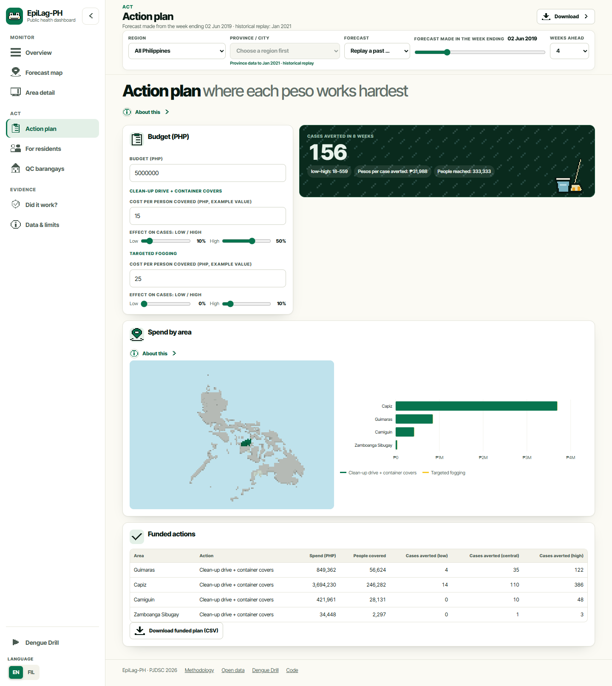

**For residents: a plain-language outlook.** This week's dengue level in Filipino or English, the DOH 4S steps,
warning signs, a message ready to share, and the same outlook in one SMS (160 characters or fewer, plain GSM
characters) with *Copy SMS* and *Send by SMS* buttons.

**Works offline.** After one visit with a connection, the dashboard opens with no signal: a service worker saves the
pages, data and map grids, and a banner says when saved data is showing. With a connection it always loads this
week's data first. Browsers that support it offer *Install app* for the home screen.

**Alert feeds.** [alerts.xml](https://romeo-04.github.io/epilag/data/alerts.xml) (RSS) lists the regions and Quezon
City on watch or outbreak warning 4 weeks ahead; [alerts.ics](https://romeo-04.github.io/epilag/data/alerts.ics)
puts every watch or warning week (2–8 weeks ahead) on a calendar. Subscribe to the calendar link in Google Calendar
or Outlook and it updates with each forecast.

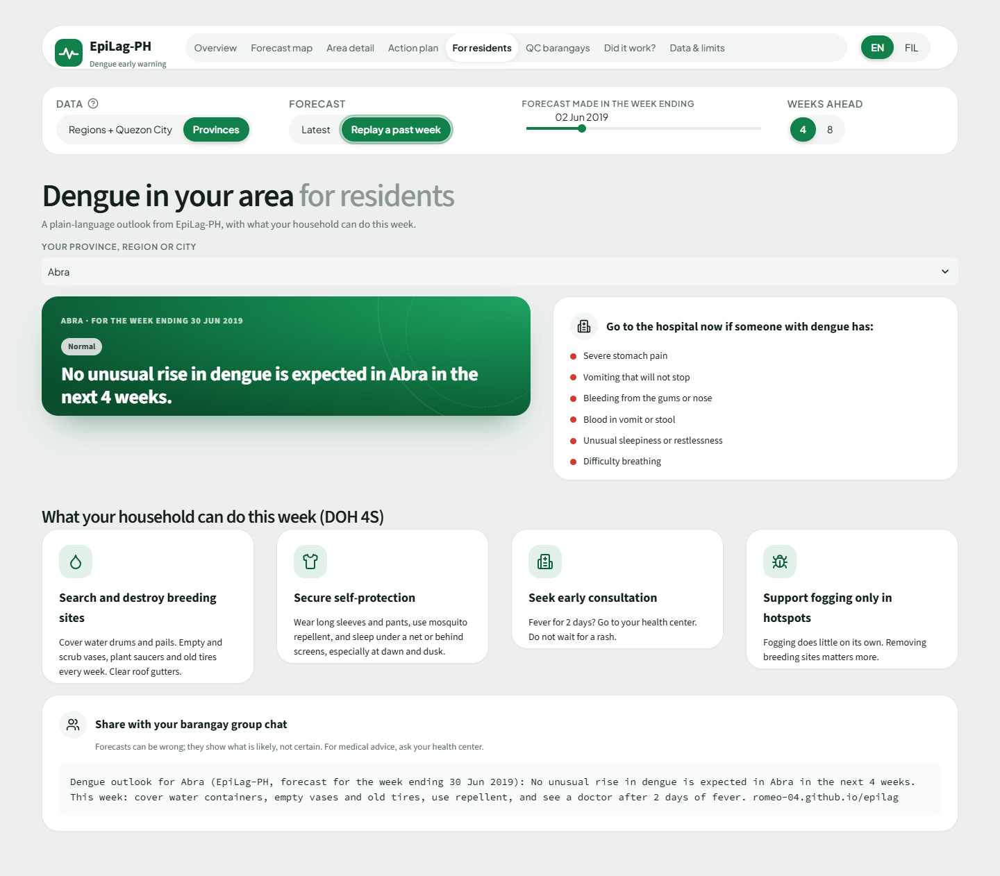

**Dengue Drill:** see [Play it](#play-it-dengue-drill) above.

## Does it work?
Every result is out of sample: each test year is forecast only from earlier years.

| | Provinces (86 units) | Regions and Quezon City |
| --- | --- | --- |
| Error vs "same week last year", 4 weeks ahead | 36% lower (2019), 89% lower (2020) | 32–70% lower (2019, 2023–2025) |
| Error vs "same as this week", 4 weeks ahead | 22% / 20% lower | 18–32% lower, except quiet 2023 (4% higher) |
| 10–90% range coverage (target 80%) | 77–79% | 70–92% |
| Outbreak starts caught 4 weeks ahead ("watch") | 87% of 211 (2019) | 79–100% |
| False alarms ("watch") | 46% (2019) | 42–63% |

- **2019 replay (week ending 2 June):** 30 of 32 provinces that later crossed the epidemic threshold were flagged
  4 weeks ahead. For regions and Quezon City it was 11 of 11.
- **Quezon City, 2024–25:** the record early-year outbreak crossed the epidemic line in the week ending 20 Oct 2024,
  stayed above it for 27 weeks and peaked at 622 cases in the week ending 23 Feb 2025 (the line was 121). The 4-week
  forecasts were on *watch* from the one made on 15 Sep 2024 and on *watch* or *outbreak warning* every week after,
  through the peak. They called the outbreak, not its height: for the peak week the forecast was 237 (likely 164–338).
- **Same budget, more cases prevented:** in the 2019 Dengue Drill, the computer player that follows EpiLag-PH's
  alerts averts **2,243 cases vs 1,792** for the one that reacts to reports (**+25%**), with the same ₱5 million in
  each of the 17 regions (the game's own scoring, central effect 30%, `scripts/drill_data.py`). In Quezon City,
  8,109 cases were reported after the first *watch* and up to the February 2025 peak: the window early action targets.
- **Honest finding on weather:** most of the skill comes from recent cases and the season. Adding rain, heat and
  humidity changed the error by about −12% to +11% depending on year and horizon (about +2% on average for regions,
  about 0% for provinces). See `reports/` and the app's *Did it work?* page.
- **Tested further after the first round:** a literature review, three other methods on the same test (LightGBM had
  the lowest error in 12 of 24 checks; no other method in more than 7) and the cause of every loss. See the
  [research page](https://romeo-04.github.io/epilag/research.html) and [`research/`](research/README.md).

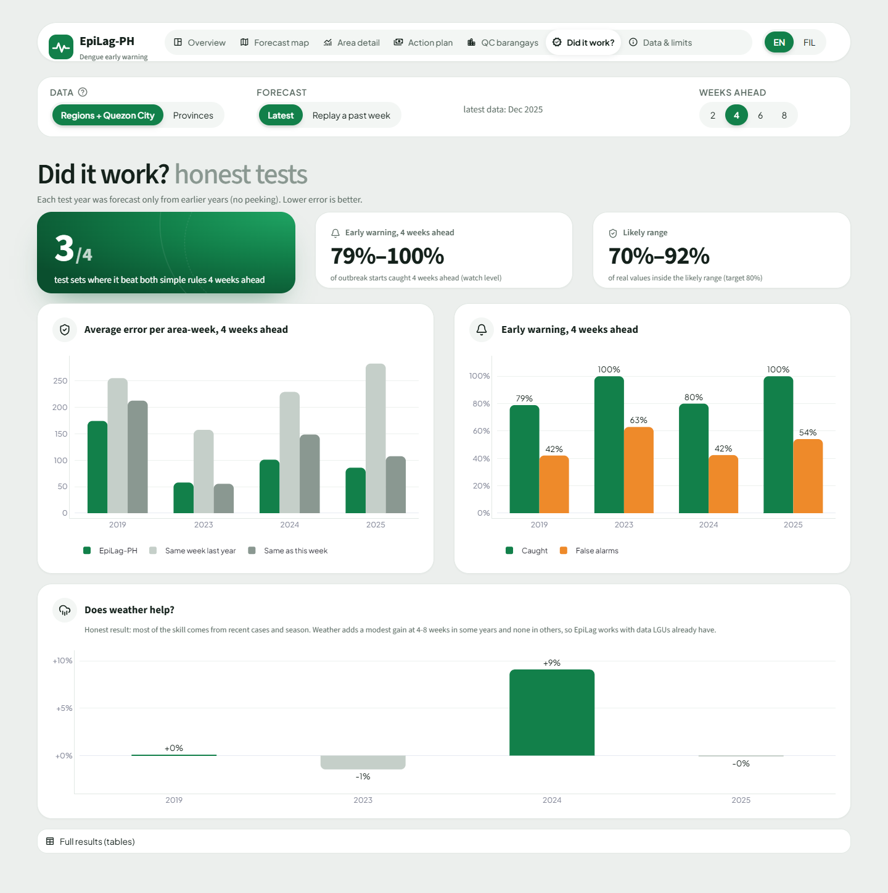

## Method
Full write-up: [methodology page](https://romeo-04.github.io/epilag/methodology.html).

- **Units:** 86 province-level units (cities folded into provinces, NCR as 4 districts, Maguindanao merged
  for 2016–2020); 17 regions; Quezon City.
- **Features:** cases in the last 4 weeks, 4- and 12-week averages, trend, same week last year; rain for each of the
  last 12 weeks and 4/8/12-week totals; heavy-rain days; humidity and temperature lags; season; population.
- **Model:** LightGBM quantile regression (10th, 50th, 90th percentiles), one model per horizon.
  Ranges are calibrated with conformalized quantile regression on the last training year.
- **Thresholds:** per area and week of year, from earlier years only: *usual* = mean,
  *epidemic* = mean + 2 SD (a common surveillance rule).
- **Explanations:** SHAP values, grouped into recent cases, season, rain by week, humidity and temperature.
- **Budget:** fractional knapsack on cases averted per peso. Effects are cautious ranges based on
  Bowman et al. (2016). Costs are example values for the LGU to replace.

## Data
| Source | Use | Licence / access |
| --- | --- | --- |
| DOH Epidemiology Bureau dengue cases and deaths 2016–2021, via HDX (PJDSC official catalogue) | province-week panel | HDX, public |
| UPRI-NOAH Dengue–Rainfall Dataset (Zenodo 19448695) | weekly regions 2016–2019, 2022–2025; Quezon City 2010–2025; QC barangay yearly | ODC-ODbL |
| ERA5 reanalysis via Open-Meteo archive API | daily rain, temperature, humidity | CC BY 4.0 |
| OCHA COD-AB / COD-PS (PSA-based) | PSGC codes, centroids, 2022 population | HDX, public |
| faeldon/philippines-json-maps | map boundaries | MIT |

## Deployment and sustainability
Full write-up: [trust and sustainability page](https://romeo-04.github.io/epilag/trust.html).

- **One weekly file in.** The only input a health office must send is weekly case counts per area, in the shape set
  by the [data contract](data/contract/README.md). `scripts/validate_cases.py` rejects a bad file (non-Sunday or
  future weeks, negative or duplicate counts) and **any column that is not a count, so patient details cannot slip in**.
- **Checked every week.** A GitHub Actions job (`.github/workflows/weekly.yml`, Mondays 09:00 PHT) checks the
  waiting files, runs the promotion gate and rebuilds the site. CI runs the tests, the contract and a full build on
  every pull request.
- **Drift is caught.** `scripts/model_gate.py` lets a retrained model go live only if, on its latest blind test year,
  4 weeks ahead, it beats "same week last year", stays within 5% of "same as this week" and covers 70–90% with its
  range. Otherwise the last good forecasts stay online.
- **Scales on a laptop.** `scripts/scale_benchmark.py` times the production training code: a full retrain takes
  25 s for 86 areas and 69 s for 1,600 (about every Philippine city and municipality) on a laptop CPU, no GPU
  (`reports/scale_benchmark.csv`). The site is static, so more users cost nothing.
- **Private and secure by design.** Counts only, no accounts, no cookies, no analytics; no server or database to attack.
- **₱0 to run.** Open data, free hosting and runners, no paid APIs. MIT-licensed code (`LICENSE`); the data keep
  their own licences.
- **Ethics.** False alarm rates are published; nothing happens automatically; budget estimates are ranges because
  under-reporting is uneven; barangay rankings stay with health offices.
- **Environment.** About a minute of CPU a week, static hosting, and a budget plan that favours clean-ups over fogging.
- **Rollout.** Pilot in Batasan Hills, Quezon City (2027–28, with a pass mark), then District 2, all of Quezon City,
  NCR and the DOH Epidemiology Bureau. No partnership is claimed.

## Limits
- Province data ends in January 2021, so the province view is a historical replay. Regions and Quezon City run to December 2025.
- Reported cases undercount infections (about 4.7× in a Cebu City study; Undurraga et al., 2017).
- One weather point per area; large provinces are simplified.
- The *watch* level catches most outbreak starts but raises many false alarms. *Outbreak warning* is stricter.
- Budget effects and costs are assumptions. They are shown as ranges and can be edited in the app.
- Quezon City barangay ranking uses yearly case shares, not weekly barangay forecasts.
- EpiLag-PH supports, and does not replace, the judgement of local epidemiologists and DOH surveillance.

## Run it
**Requirements:** Python 3.12 and Node.js 24 (the versions we build and test with), and Git. Clone the repository
first:
```bash
git clone https://github.com/Romeo-04/epilag.git
cd epilag
```

The website, app and game are built with Vite from `site/` into `docs/` (served by GitHub Pages):
```bash
cd site
npm ci
npm run dev        # http://localhost:5173/epilag/
npm run build      # writes the pages into ../docs
```

The Python side makes the data the site reads, and holds the tests:
```bash
python -m venv .venv
.venv/Scripts/pip install -r requirements.txt      # or .venv/bin/pip on macOS/Linux
python scripts/build_web.py                        # app data (site/public/web/data) and EN/FIL copy
pytest tests                                       # needs Playwright and a built site for the browser tests
python scripts/validate_cases.py data/contract/weekly_cases_template.csv   # check a weekly case file
python scripts/model_gate.py                       # the promotion gate on reports/
python scripts/scale_benchmark.py                  # retrain timings at 86, 400 and 1,600 areas
streamlit run app/streamlit_app.py                 # the original Streamlit app, kept for local use
```

The tests check that the JavaScript app computes what the Python does (alert levels, thresholds, replays, the
"30 of 32" claim, budget plans, each area's alert track record), that the game scores like `scripts/drill_data.py`,
that every page loads without errors, fits a phone, works with reduced motion and the keyboard, and passes an
accessibility scan, that the dashboard works offline after one visit and the area report prints on one page, that
every SMS fits in 160 characters, and that the alert feeds are valid RSS and iCalendar.

<details>
<summary>Rebuild everything from the raw data</summary>

```bash
python src/fetch_data.py         # HDX dengue, admin codes, population, UPRI-NOAH regional/QC data
python src/clean_dengue.py       # province-week panel (86 units, PSGC codes)
python src/fetch_weather.py      # ERA5 daily weather (Open-Meteo); waits out the free-tier hourly limit
python src/features.py
python src/backtest.py province && python src/backtest.py province --no-weather
python src/backtest.py region_qc && python src/backtest.py region_qc --no-weather
python src/alerts.py province && python src/alerts.py region_qc
python src/train_final.py province && python src/train_final.py region_qc
python src/export_app_data.py
python scripts/make_figures.py
python scripts/drill_data.py         # Dengue Drill season data (site/public/drill/data.json)
python scripts/qc_drill_data.py      # Dengue Drill Quezon City mission (site/public/drill/qc.json, geo/voxel_qc.json)
python scripts/drill_models.py       # Dengue Drill round 2: every model's forecasts (site/public/drill/models.json)
python scripts/research_docs.py      # Research page reader: the research documents as pages (site/public/research/)
python scripts/export_open_data.py   # open forecast and track-record files, RSS and calendar feeds (docs/data/)
python scripts/build_web.py          # app data and EN/FIL copy
python scripts/voxel_data.py         # 3D map grids (site/public/geo/)
python scripts/landing_data.py       # the landing page's 2019 replay numbers
python scripts/og_image.py           # social card (site/public/og.png)
python scripts/pwa_icons.py          # app icons for the installable app (site/public/icons/)
python scripts/screenshots.py        # docs/screenshots, from the built site
```
</details>

## Documentation
| Document | For | What it covers |
| --- | --- | --- |
| [Methodology page](https://romeo-04.github.io/epilag/methodology.html) | Everyone | Data, cleaning, inputs, model, calibration, alerts, validation, pilot plan, targets and roadmap, in plain words |
| [Trust and sustainability page](https://romeo-04.github.io/epilag/trust.html) | Health offices, partners, judges | Data privacy, the weekly cycle, the promotion gate, scale, cost, ethics and rollout |
| [Data contract](data/contract/README.md) | Health offices, data partners | The one weekly file a health office sends, its columns and the checks it must pass |
| [Research paper (PDF)](research/EpiLag-PH-research-paper.pdf) and [`research/README.md`](research/README.md) | Reviewers, researchers | The literature review, three other methods, new inputs and the cause of every loss |
| [`research/results/README.md`](research/results/README.md) and [`METHODS.md`](research/results/METHODS.md) | Researchers | Every research result, the file it comes from and how each experiment ran |
| [Open data guide](docs/data/README.md) | Researchers, newsrooms, other apps | The forecast and track-record files, their columns and the alert feeds |
| [Slides (PDF)](docs/deck/EpiLag-PH_deck.pdf) and [`deck_build/README.md`](deck_build/README.md) | Judges, partners | The final-round deck, and how it is rebuilt from the repository's results |
| [`src/README.md`](src/README.md) | Developers | The pipeline steps in order, with what each reads and writes |
| [`scripts/README.md`](scripts/README.md) | Developers | What each script writes for the site, the game and the documents |
| [`site/README.md`](site/README.md) | Developers | The website, app and game: pages, source folders and build |
| [`tests/README.md`](tests/README.md) | Developers | What each test checks and how to run it |
| [`reports/README.md`](reports/README.md) | Developers, reviewers | The result files and their columns |
| [`app/README.md`](app/README.md) | Developers | The original Streamlit app and its data files |

## Repository
```
epilag/
├── site/           Website, app and game source (Vite). See site/README.md
│   ├── src/        app/ (dashboard), drill/ (3D game), landing/, pages/,
│   │               lib/ (sprites, voxel maps), css/ (design tokens)
│   └── public/     Data, map grids, sprites and icons copied into the build
├── docs/           The built site for GitHub Pages, plus the demo video, open data (data/),
│                   deck (deck/), figures and screenshots. Pages are written by npm run build:
│                   edit site/, not docs/
├── src/            The forecasting pipeline: fetch, clean, weather, features, backtest,
│                   alerts, train, export, and the shared rules (thresholds, reliability,
│                   allocate). See src/README.md
├── scripts/        Data for the site and the game, map grids, figures, screenshots.
│                   See scripts/README.md
├── reports/        Out-of-sample test results of the submitted model (CSV).
│                   See reports/README.md
├── research/       Post-first-round research: literature, model experiments, results,
│                   analysis, paper. See research/README.md
├── tests/          Python and browser tests (pytest, Playwright). See tests/README.md
├── app/            The original Streamlit app and its small data files. See app/README.md
├── data/contract/  The weekly case file a health office sends, with an example.
│                   data/incoming/ holds files waiting to be checked
├── .github/        CI on every pull request, and the weekly check (contract, promotion gate,
│                   site build)
├── deck_build/     Rebuilds the final-round deck from the repository's results.
│                   See deck_build/README.md
├── .streamlit/     Streamlit settings for app/
├── requirements.txt
│                   Python dependencies
├── LICENSE         MIT, for the code (the data keep their own licences)
├── vercel.json     Optional second deploy of docs/ on Vercel (the main site is GitHub Pages)
└── data/raw/, data/processed/
                    Raw and processed data, made by src/fetch_data.py and the pipeline
                    (not committed)
```

## References
- Bowman, L. R., Donegan, S., & McCall, P. J. (2016). Is dengue vector control deficient in effectiveness or evidence?: Systematic review and meta-analysis. *PLOS Neglected Tropical Diseases, 10*(3), e0004551. https://doi.org/10.1371/journal.pntd.0004551
- Olana, K. O. A., Poprom, N., Siewchaisakul, P., Punyapornwithaya, V., & Thongprachum, A. (2025). Spatial distribution analysis and comparative forecasting of dengue resurgence in the Philippines (2025–2027): A nationwide study. *Transboundary and Emerging Diseases, 2025*, 7480710. https://doi.org/10.1155/tbed/7480710
- Undurraga, E. A., et al. (2017). Disease burden of dengue in the Philippines: Adjusting for underreporting by comparing active and passive dengue surveillance in Punta Princesa, Cebu City. *American Journal of Tropical Medicine and Hygiene, 96*(4), 887–898. https://doi.org/10.4269/ajtmh.16-0488
- Romano, Y., Patterson, E., & Candès, E. (2019). Conformalized quantile regression. *Advances in Neural Information Processing Systems 32*.
- Pelitro, K. J., et al. (2026). Weekly dengue incidence linked to satellite rainfall at city, regional, and country scales (v1.0.0) [Data set]. Zenodo. https://zenodo.org/records/19448695
