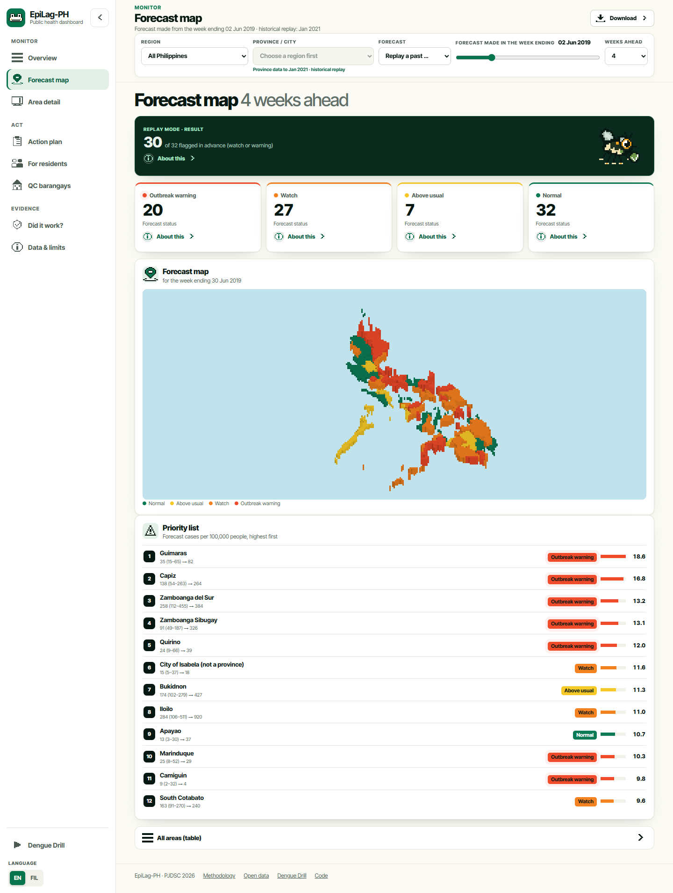

# EpiLag-PH

**Dengue early warning for Philippine LGUs: forecast cases 2–8 weeks ahead, flag likely outbreaks,
and show where a limited budget prevents the most cases.**

Entry for the Philippine Junior Data Science Challenge (PJDSC) 2026,
*Trace the Pattern, Target the Cure: Advancing Public Health Through Data Science.*

**Try it:** [romeo-04.github.io/epilag/web](https://romeo-04.github.io/epilag/web/) (runs in your browser; first load takes about a minute) ·
[Slides (PDF)](docs/deck/EpiLag-PH_deck.pdf) · [Demo video](docs/demo.webm)



## The problem
Dengue response in most LGUs starts when hospital admissions are already high. Reports reach the
surveillance system after patients are sick, so clean-up drives and fogging often arrive after the peak.
The Philippines reported about 442,000 cases in 2019 (DOH via HDX), and true infections are several times
higher than reported.

## What EpiLag-PH does
1. **Forecasts** weekly cases 2, 4, 6 and 8 weeks ahead for each area, with a likely range.
2. **Flags** areas with alert levels: *normal*, *above usual*, *watch* (an outbreak is possible) and
   *outbreak warning*. It also explains each forecast (recent cases, season, rain, heat, humidity).
3. **Plans** a budget: it ranks where clean-up drives and fogging avert the most forecast cases per peso,
   with low/central/high estimates.

## Results (out of sample: each test year forecast only from earlier years)
| | Provinces (86 units) | Regions + Quezon City |
| --- | --- | --- |
| Error vs "same week last year", 4 weeks ahead | 36% lower (2019), 89% lower (2020) | 32–70% lower (2019, 2023–2025) |
| Error vs "same as this week", 4 weeks ahead | 22% / 20% lower | 18–32% lower, except quiet 2023 (4% higher) |
| 10–90% range coverage (target 80%) | 77–79% | 70–92% |
| Outbreak starts caught 4 weeks ahead ("watch") | 87% of 211 (2019) | 79–100% |
| False alarms ("watch") | 46% (2019) | 42–63% |

**Replay, week ending 2 June 2019:** 30 of the 32 provinces that later crossed the epidemic threshold
were flagged 4 weeks ahead (regions and Quezon City: 11 of 11).

**Quezon City, 2025:** the record early-year outbreak (peak 622 cases in the week ending 23 Feb 2025)
was on *watch* from forecasts issued on 8 Dec 2024 (4 weeks ahead).

**Honest finding on weather:** most of the skill comes from recent cases and the season. Adding rain,
heat and humidity changed the error by about −12% to +11% depending on year and horizon (about +2% on
average for regions, about 0% for provinces). See `reports/` and the app's *Did it work?* page.

## Run it
```bash
python -m venv .venv
.venv/Scripts/pip install -r requirements.txt      # or .venv/bin/pip on macOS/Linux
streamlit run app/streamlit_app.py                 # the app runs from committed files in app/data
python scripts/build_web.py                        # rebuild the in-browser version in docs/web
pytest tests                                       # 54 tests
```

Rebuild everything from the raw data:
```bash
python src/fetch_data.py         # HDX dengue, admin codes, population, UPRI-NOAH regional/QC data
python src/clean_dengue.py       # province-week panel (86 units, PSGC codes)
python src/fetch_weather.py      # ERA5 daily weather (Open-Meteo); waits out the free-tier hourly limit
python src/features.py
python src/backtest.py province && python src/backtest.py province --no-weather
python src/backtest.py region_qc && python src/backtest.py region_qc --no-weather
python src/alerts.py province && python src/alerts.py region_qc
python src/train_final.py province && python src/train_final.py region_qc
python src/export_app_data.py
python scripts/make_figures.py
```

## Method
- **Units:** 86 province-level units (cities folded into provinces, NCR as 4 districts, Maguindanao merged
  for 2016–2020); 17 regions; Quezon City.
- **Features:** cases in the last 4 weeks, 4- and 12-week averages, trend, same week last year; rain for each of the
  last 12 weeks and 4/8/12-week totals; heavy-rain days; humidity and temperature lags; season; population.
- **Model:** LightGBM quantile regression (10th, 50th, 90th percentiles), one model per horizon.
  Ranges are calibrated with conformalized quantile regression on the last training year.
- **Thresholds:** per area and week of year from earlier years only: *usual* = mean,
  *epidemic* = mean + 2 SD (a common surveillance rule).
- **Explanations:** SHAP values, grouped into recent cases, season, rain by week, humidity, temperature.
- **Budget:** fractional knapsack on cases averted per peso. Effects are cautious ranges anchored to
  Bowman et al. (2016); costs are example values for the LGU to replace.

## Data
| Source | Use | Licence / access |
| --- | --- | --- |
| DOH Epidemiology Bureau dengue cases and deaths 2016–2021, via HDX (PJDSC official catalogue) | province-week panel | HDX, public |
| UPRI-NOAH Dengue–Rainfall Dataset (Zenodo 19448695) | weekly regions 2016–2019, 2022–2025; Quezon City 2010–2025; QC barangay yearly | ODC-ODbL |
| ERA5 reanalysis via Open-Meteo archive API | daily rain, temperature, humidity | CC BY 4.0 |
| OCHA COD-AB / COD-PS (PSA-based) | PSGC codes, centroids, 2022 population | HDX, public |
| faeldon/philippines-json-maps | map boundaries | MIT |

## Limits
- Province data ends in January 2021, so the province view is a historical replay. Regions and Quezon City run to December 2025.
- Reported cases undercount infections (about 4.7× in a Cebu City study; Undurraga et al., 2017).
- One weather point per area; large provinces are simplified.
- The *watch* level catches most outbreak starts but raises many false alarms; *outbreak warning* is stricter.
- Budget effects and costs are assumptions, shown as ranges and editable in the app.
- Quezon City barangay ranking uses yearly case shares, not weekly barangay forecasts.

## Repository
```
app/            Streamlit app and its small data files
src/            pipeline: fetch, clean, weather, features, backtest, alerts, train, allocate, export
tests/          unit tests (allocation) and app smoke tests
reports/        backtest, early-warning, ablation and SHAP results (CSV)
docs/           deck, figures, screenshots, video script
scripts/        figure and screenshot generators
```

## References
- Bowman, L. R., Donegan, S., & McCall, P. J. (2016). Is dengue vector control deficient in effectiveness or evidence?: Systematic review and meta-analysis. *PLOS Neglected Tropical Diseases, 10*(3), e0004551. https://doi.org/10.1371/journal.pntd.0004551
- Olana, K. O. A., Poprom, N., Siewchaisakul, P., Punyapornwithaya, V., & Thongprachum, A. (2025). Spatial distribution analysis and comparative forecasting of dengue resurgence in the Philippines (2025–2027): A nationwide study. *Transboundary and Emerging Diseases, 2025*, 7480710. https://doi.org/10.1155/tbed/7480710
- Undurraga, E. A., et al. (2017). Disease burden of dengue in the Philippines: Adjusting for underreporting by comparing active and passive dengue surveillance in Punta Princesa, Cebu City. *American Journal of Tropical Medicine and Hygiene, 96*(4), 887–898. https://doi.org/10.4269/ajtmh.16-0488
- Romano, Y., Patterson, E., & Candès, E. (2019). Conformalized quantile regression. *Advances in Neural Information Processing Systems 32*.
- Pelitro, K. J., et al. (2026). Weekly dengue incidence linked to satellite rainfall at city, regional, and country scales (v1.0.0) [Data set]. Zenodo. https://zenodo.org/records/19448695
