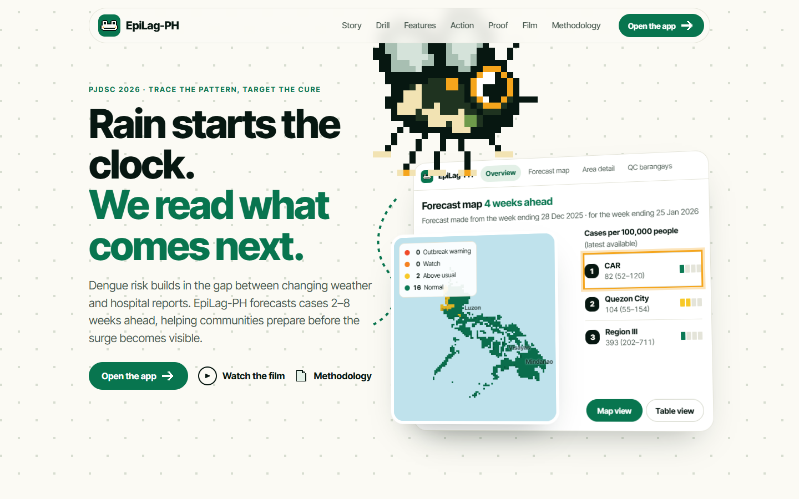
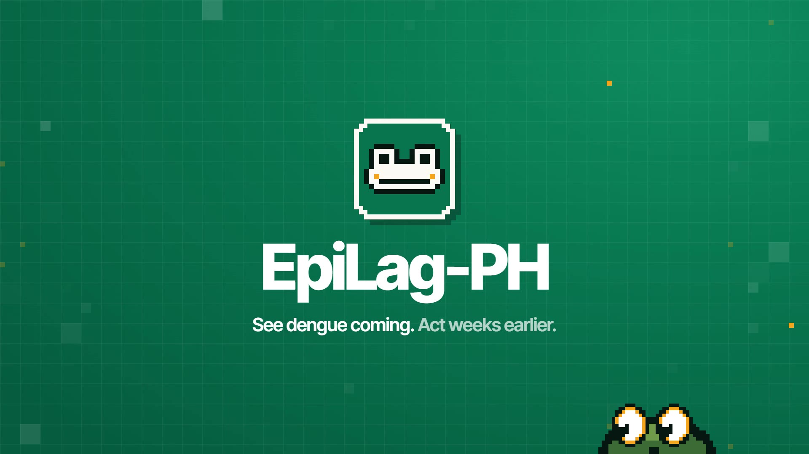
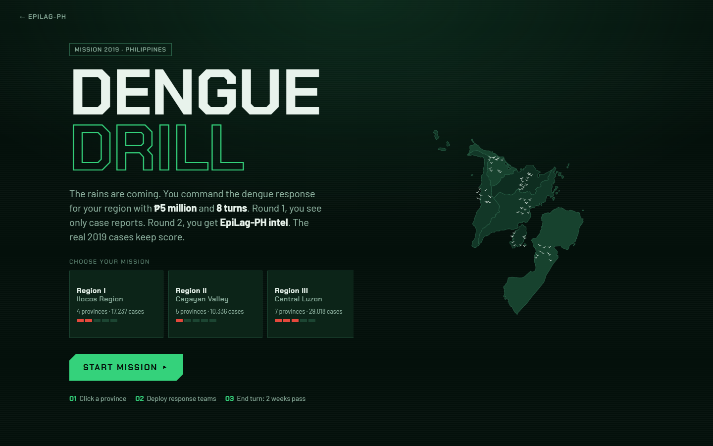
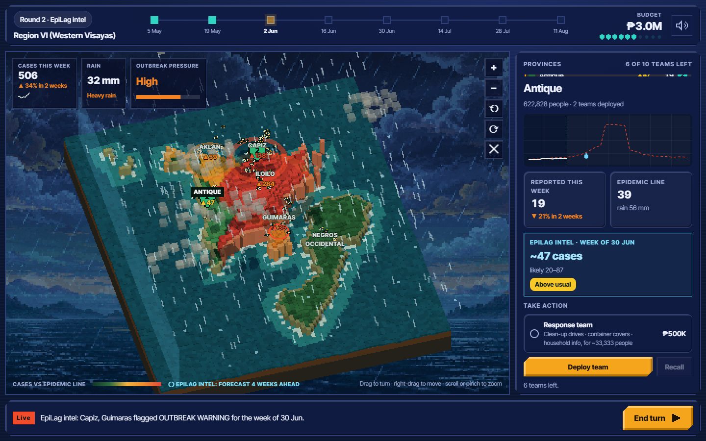
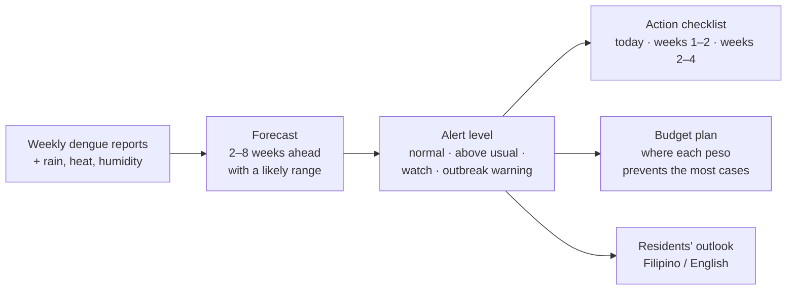
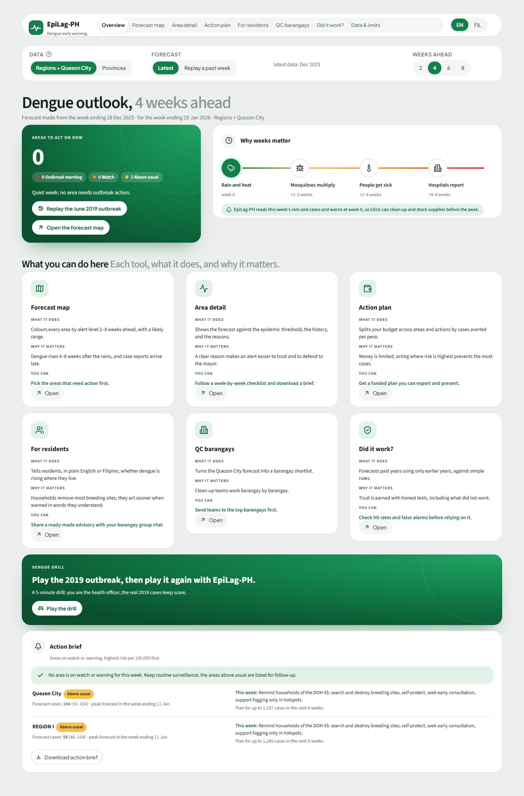
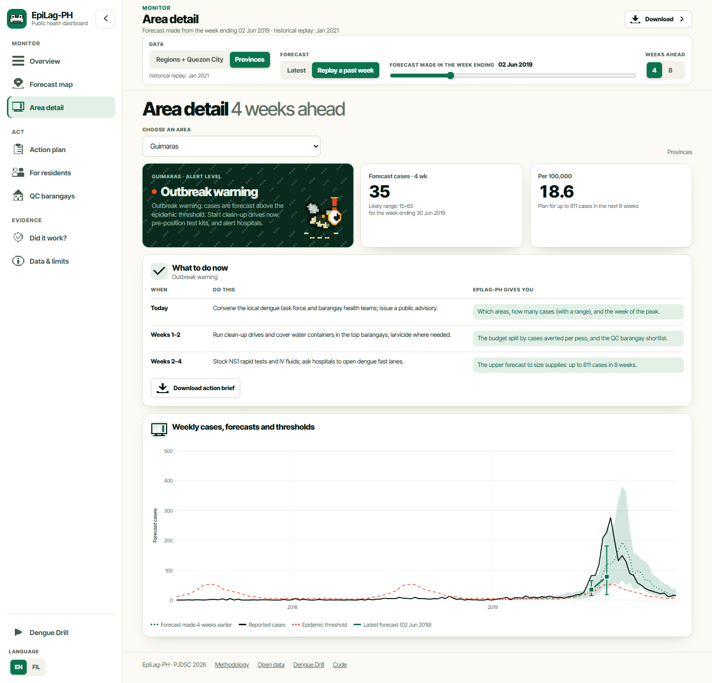
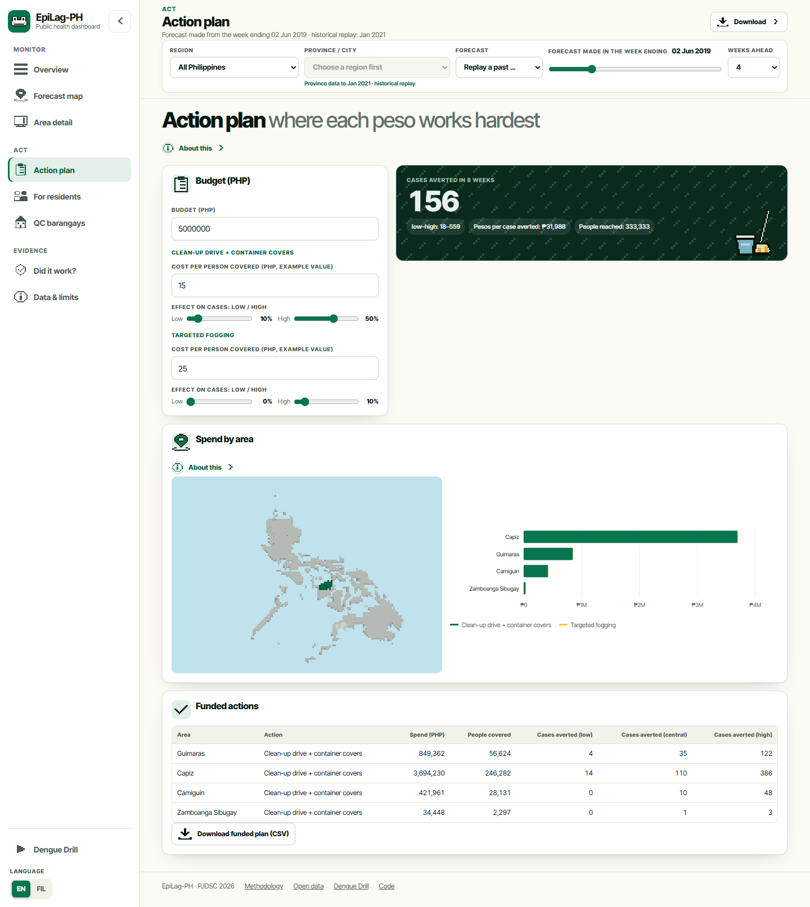
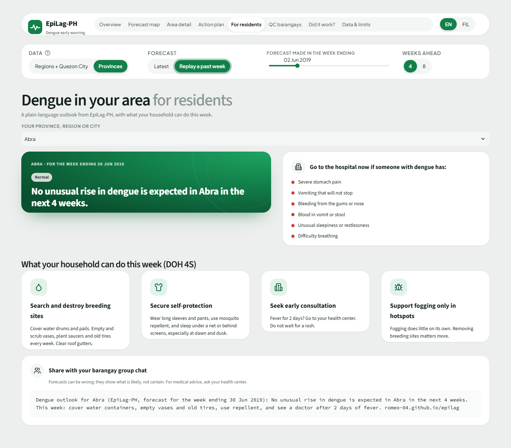
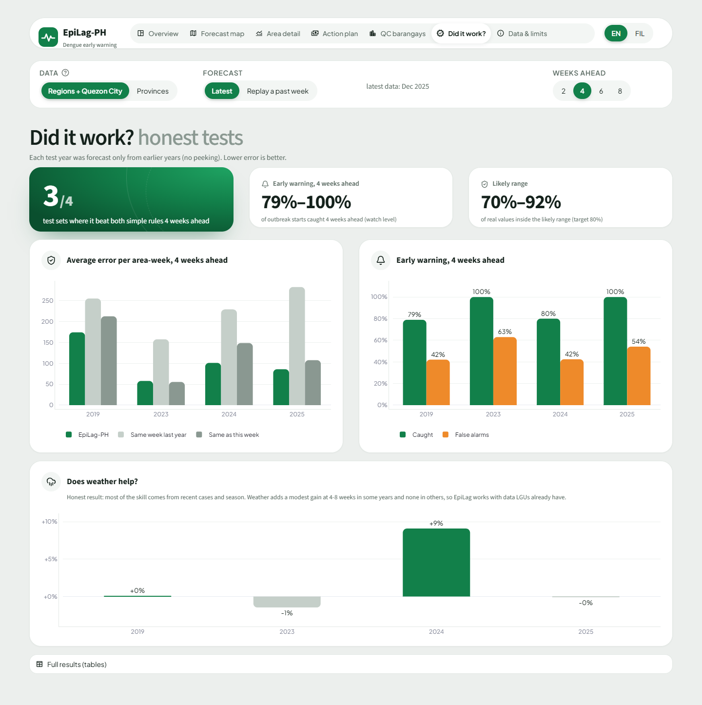

# EpiLag-PH

**Dengue warning weeks before the wards fill up.** EpiLag-PH forecasts dengue cases 2–8 weeks ahead for
Philippine provinces, regions and Quezon City. It says which areas are heading for an outbreak, what the local
health office should do this week, and where a limited budget prevents the most cases.

Entry for the Philippine Junior Data Science Challenge (PJDSC) 2026,
*Trace the Pattern, Target the Cure: Advancing Public Health Through Data Science.*

| [Website](https://romeo-04.github.io/epilag/) | [Live app](https://romeo-04.github.io/epilag/web/) | [Dengue Drill](https://romeo-04.github.io/epilag/drill/) | [Film (2:09)](docs/demo.mp4) | [Slides (PDF)](docs/deck/EpiLag-PH_deck.pdf) | [Methodology](https://romeo-04.github.io/epilag/methodology.html) | [Open data](https://romeo-04.github.io/epilag/data/) |
| --- | --- | --- | --- | --- | --- | --- |

Everything runs in your browser, with no install or account: the app is ready in about 3 seconds, and the maps and
the game are drawn as 3D pixel art.



## Watch the film
[](docs/demo.mp4)

**[▶ Watch the film (2:09, MP4)](docs/demo.mp4)**, also on the [website](https://romeo-04.github.io/epilag/#film).
It follows Quezon City's 2024–25 outbreak, the latest data: 27 weeks above the epidemic line and a peak of 622 cases a
week in February 2025. Then it replays the forecasts made at the time, which flagged the city 5 weeks before it crossed
the line, and walks through the barangay shortlist, the Dengue Drill's Quezon City mission, and the 2019 replay as the
nationwide proof. No voice-over: the on-screen text tells the story.

## In one minute
- **Problem:** dengue response usually starts after hospital admissions are already high. Cases are reported after
  people get sick, so clean-up drives and fogging often arrive after the peak. The Philippines reported about
  442,000 cases in 2019 (DOH via HDX), and true infections are several times higher.
- **Insight:** an outbreak gives early signs. Cases start rising above the usual level for the season, and rain fills
  breeding sites weeks before mosquitoes multiply. That lag is time a health office can use.
- **Solution:** EpiLag-PH turns those signs into a forecast with a likely range, an alert level, a week-by-week
  checklist, a budget plan and a plain-language message for residents.
- **Proof, latest data:** Quezon City's 2024–25 outbreak stayed above its epidemic line for 27 weeks and peaked at
  622 cases a week (five times the line) in February 2025. EpiLag-PH's out-of-sample forecasts flagged it **5 weeks
  before it crossed the line**, and kept it flagged every week to the peak.
- **Proof, nationwide:** in a replay of 2019 using only data available on 2 June, **30 of the 32 provinces** that
  later crossed the epidemic threshold were flagged 4 weeks ahead.

## Play it: Dengue Drill
**[▶ Play Dengue Drill in your browser](https://romeo-04.github.io/epilag/drill/)**. No install needed.

Forecasts are easy to ignore until you feel what they are worth. Dengue Drill makes you the health officer for one area
during a real outbreak. The first mission is the latest: **Quezon City's 2024–25 season, barangay by barangay** (142
barangays). The other 17 missions are the regions during the 2019 outbreak, the year the Philippines declared a
national dengue epidemic.

Your area is a 3D pixel island: each province or barangay rises higher and redder as its cases pass its epidemic line,
rain falls as heavily as it did that week (storms bring lightning), mosquitoes swarm after the rain, and outbreaks glow.
Drag to turn the island, scroll or pinch to zoom.

Quezon City reports weekly cases only for the whole city, so the mission's barangay numbers are estimates, and the game
says so: each barangay gets the city's weekly cases times its share of the city's 2025 cases, and the EpiLag-PH intel is
the real city forecast made that week, shared out the same way. There is no city rain series, so that mission has no
rain.

| | |
| --- | --- |
|  |  |

1. **Pick a mission.** You get ₱5 million in response teams and 8 turns (from November 2024 in Quezon City, May 2019
   in the regions). Each turn is 2 weeks.
2. **Read the receipt.** Before you start, a receipt lists the season's cases (and, for the regions, its rain), area by area.
3. **Round 1: react.** You see only case reports, just as most health offices do today. Deploy teams to provinces, then end the turn.
4. **Round 2: forecast.** Same region, same budget, now with EpiLag-PH alerts and forecast ranges on the map.
5. **Get scored on real data.** Each team prevents a share of the cases reported 2–9 weeks after it is deployed. After
   each round you get a mission report and a grade based on the real cases. At the end, your two rounds are
   compared with two computer players: one that reacts to reports and one that follows EpiLag-PH.

In test runs of the 2019 missions, the computer player that follows EpiLag-PH's alerts averted more cases than the one
reacting to reports in **11 of 17 regions** (about the same in 1, fewer in 5). The game shows this result honestly, including the regions where
early action did not pay off.

## How it works


1. **Forecast.** A model trained on past outbreaks estimates next weeks' reported cases for each area, with a
   low–middle–high range.
2. **Alert.** Each forecast is compared with that area's normal level for the same week in earlier years.
   *Watch* means an outbreak is possible. *Outbreak warning* means one is likely.
3. **Act.** Every alert comes with what to do, when to do it, and what EpiLag-PH contributes to each step.
   The checklist can be downloaded as a one-page action brief.
4. **Allocate.** Given a budget, EpiLag-PH ranks where clean-up drives and fogging avert the most forecast cases
   per peso, with cautious low/central/high estimates.

## Who it is for
| User | What they get |
| --- | --- |
| **Provincial, city and municipal health offices** | Alert map, area checklists, action brief, budget plan, and an explanation of why each area is flagged |
| **Barangays and residents** | A *For residents* page with this week's outlook, the DOH 4S steps, warning signs, and a message ready to share in a group chat |
| **Trainees, students and the public** | [Dengue Drill](https://romeo-04.github.io/epilag/drill/), a game where you run the response yourself, from Quezon City's barangays in 2024–25 to the 2019 regions |
| **Researchers, newsrooms and other apps** | Every forecast as [CSV and JSON](https://romeo-04.github.io/epilag/data/), with column definitions |

## What you can do
**Overview: see this week's priorities.** The app opens on a dashboard: how many areas need action now, a 3D map of
the forecast, the priority list, and this week's action brief. The sidebar groups the tools into *Monitor*, *Act* and
*Evidence*; explanations sit behind "About this" buttons, in English and Filipino.

**Pick the area, from latest to most specific.** The settings bar has two dropdowns. *Region* is All Philippines or one
of 17 regions (the latest data, to December 2025). *Province / city* then lists only that region: the whole region,
Quezon City under NCR (also to December 2025), and the region's provinces, marked as data to January 2021 and opened
as a historical replay limited to that region's provinces.



**Forecast map: where to act first.** Columns rise with the alert level; hover for the numbers, click to open an area.
In replay mode it shows what happened next.


**Area page: know what to do and why.** Each area shows its forecast range, alert level, checklist, and the
factors behind the forecast (recent cases, season, rain, heat, humidity).



**Budget: spend where it counts.** Enter a budget and get a ranked plan you can export as CSV.



**For residents: a plain-language outlook.** This week's dengue level in Filipino or English, the DOH 4S steps,
warning signs, and a message ready to share.



**Dengue Drill:** see [Play it](#play-it-dengue-drill) above.

## Does it work?
Every result is out of sample: each test year is forecast only from earlier years.

| | Provinces (86 units) | Regions and Quezon City |
| --- | --- | --- |
| Error vs "same week last year", 4 weeks ahead | 36% lower (2019), 89% lower (2020) | 32–70% lower (2019, 2023–2025) |
| Error vs "same as this week", 4 weeks ahead | 22% / 20% lower | 18–32% lower, except quiet 2023 (4% higher) |
| 10–90% range coverage (target 80%) | 77–79% | 70–92% |
| Outbreak starts caught 4 weeks ahead ("watch") | 87% of 211 (2019) | 79–100% |
| False alarms ("watch") | 46% (2019) | 42–63% |

- **2019 replay (week ending 2 June):** 30 of 32 provinces that later crossed the epidemic threshold were flagged
  4 weeks ahead. For regions and Quezon City it was 11 of 11.
- **Quezon City, 2024–25:** the record early-year outbreak crossed the epidemic line in the week ending 20 Oct 2024,
  stayed above it for 27 weeks and peaked at 622 cases in the week ending 23 Feb 2025 (the line was 121). The 4-week
  forecasts were on *watch* from the one made on 15 Sep 2024 and on *watch* or *outbreak warning* every week after,
  through the peak. They called the outbreak, not its height: for the peak week the forecast was 237 (likely 164–338).
- **Honest finding on weather:** most of the skill comes from recent cases and the season. Adding rain, heat and
  humidity changed the error by about −12% to +11% depending on year and horizon (about +2% on average for regions,
  about 0% for provinces). See `reports/` and the app's *Did it work?* page.



## Method
Full write-up: [methodology page](https://romeo-04.github.io/epilag/methodology.html).

- **Units:** 86 province-level units (cities folded into provinces, NCR as 4 districts, Maguindanao merged
  for 2016–2020); 17 regions; Quezon City.
- **Features:** cases in the last 4 weeks, 4- and 12-week averages, trend, same week last year; rain for each of the
  last 12 weeks and 4/8/12-week totals; heavy-rain days; humidity and temperature lags; season; population.
- **Model:** LightGBM quantile regression (10th, 50th, 90th percentiles), one model per horizon.
  Ranges are calibrated with conformalized quantile regression on the last training year.
- **Thresholds:** per area and week of year, from earlier years only: *usual* = mean,
  *epidemic* = mean + 2 SD (a common surveillance rule).
- **Explanations:** SHAP values, grouped into recent cases, season, rain by week, humidity and temperature.
- **Budget:** fractional knapsack on cases averted per peso. Effects are cautious ranges based on
  Bowman et al. (2016). Costs are example values for the LGU to replace.

## Data
| Source | Use | Licence / access |
| --- | --- | --- |
| DOH Epidemiology Bureau dengue cases and deaths 2016–2021, via HDX (PJDSC official catalogue) | province-week panel | HDX, public |
| UPRI-NOAH Dengue–Rainfall Dataset (Zenodo 19448695) | weekly regions 2016–2019, 2022–2025; Quezon City 2010–2025; QC barangay yearly | ODC-ODbL |
| ERA5 reanalysis via Open-Meteo archive API | daily rain, temperature, humidity | CC BY 4.0 |
| OCHA COD-AB / COD-PS (PSA-based) | PSGC codes, centroids, 2022 population | HDX, public |
| faeldon/philippines-json-maps | map boundaries | MIT |

## Limits
- Province data ends in January 2021, so the province view is a historical replay. Regions and Quezon City run to December 2025.
- Reported cases undercount infections (about 4.7× in a Cebu City study; Undurraga et al., 2017).
- One weather point per area; large provinces are simplified.
- The *watch* level catches most outbreak starts but raises many false alarms. *Outbreak warning* is stricter.
- Budget effects and costs are assumptions. They are shown as ranges and can be edited in the app.
- Quezon City barangay ranking uses yearly case shares, not weekly barangay forecasts.
- EpiLag-PH supports, and does not replace, the judgement of local epidemiologists and DOH surveillance.

## Run it
The website, app and game are built with Vite from `site/` into `docs/` (served by GitHub Pages):
```bash
cd site
npm ci
npm run dev        # http://localhost:5173/epilag/
npm run build      # writes the pages into ../docs
```

The Python side makes the data the site reads, and holds the tests:
```bash
python -m venv .venv
.venv/Scripts/pip install -r requirements.txt      # or .venv/bin/pip on macOS/Linux
python scripts/build_web.py                        # app data (site/public/web/data) and EN/FIL copy
pytest tests                                       # needs Playwright and a built site for the browser tests
streamlit run app/streamlit_app.py                 # the original Streamlit app, kept for local use
```

The tests check that the JavaScript app computes what the Python does (alert levels, thresholds, replays, the
"30 of 32" claim, budget plans), that the game scores like `scripts/drill_data.py`, and that every page loads without
errors, fits a phone, works with reduced motion and the keyboard, and passes an accessibility scan.

<details>
<summary>Rebuild everything from the raw data</summary>

```bash
python src/fetch_data.py         # HDX dengue, admin codes, population, UPRI-NOAH regional/QC data
python src/clean_dengue.py       # province-week panel (86 units, PSGC codes)
python src/fetch_weather.py      # ERA5 daily weather (Open-Meteo); waits out the free-tier hourly limit
python src/features.py
python src/backtest.py province && python src/backtest.py province --no-weather
python src/backtest.py region_qc && python src/backtest.py region_qc --no-weather
python src/alerts.py province && python src/alerts.py region_qc
python src/train_final.py province && python src/train_final.py region_qc
python src/export_app_data.py
python scripts/make_figures.py
python scripts/drill_data.py         # Dengue Drill season data (site/public/drill/data.json)
python scripts/qc_drill_data.py      # Dengue Drill Quezon City mission (site/public/drill/qc.json, geo/voxel_qc.json)
python scripts/export_open_data.py   # open forecast files (docs/data/)
python scripts/build_web.py          # app data and EN/FIL copy
python scripts/voxel_data.py         # 3D map grids (site/public/geo/)
python scripts/landing_data.py       # the landing page's 2019 replay numbers
python scripts/og_image.py           # social card (site/public/og.png)
python scripts/screenshots.py        # docs/screenshots, from the built site
python scripts/film_data.py          # the film's maps and Quezon City season (docs/film/data.js)
python scripts/record_film.py        # docs/demo.mp4, recorded from docs/film/index.html
```
</details>

## Repository
```
site/           the website, app and game (Vite): pages, src/app (dashboard), src/drill (3D game),
                src/landing, src/lib (pixel sprites, voxel maps, motion), public/ (data, sprites, grids)
docs/           the built site for GitHub Pages, plus open data (data/), film (film/, demo.mp4), deck,
                figures and screenshots
src/            pipeline: fetch, clean, weather, features, backtest, alerts, train, allocate, export
app/            the original Streamlit app and its small data files
tests/          allocation, JS/Python parity, game rules, site checks (Playwright), Streamlit smoke tests
reports/        backtest, early-warning, ablation and SHAP results (CSV)
scripts/        data for the site, sprites, voxel grids, figures, screenshots, social card, film recording
```

## References
- Bowman, L. R., Donegan, S., & McCall, P. J. (2016). Is dengue vector control deficient in effectiveness or evidence?: Systematic review and meta-analysis. *PLOS Neglected Tropical Diseases, 10*(3), e0004551. https://doi.org/10.1371/journal.pntd.0004551
- Olana, K. O. A., Poprom, N., Siewchaisakul, P., Punyapornwithaya, V., & Thongprachum, A. (2025). Spatial distribution analysis and comparative forecasting of dengue resurgence in the Philippines (2025–2027): A nationwide study. *Transboundary and Emerging Diseases, 2025*, 7480710. https://doi.org/10.1155/tbed/7480710
- Undurraga, E. A., et al. (2017). Disease burden of dengue in the Philippines: Adjusting for underreporting by comparing active and passive dengue surveillance in Punta Princesa, Cebu City. *American Journal of Tropical Medicine and Hygiene, 96*(4), 887–898. https://doi.org/10.4269/ajtmh.16-0488
- Romano, Y., Patterson, E., & Candès, E. (2019). Conformalized quantile regression. *Advances in Neural Information Processing Systems 32*.
- Pelitro, K. J., et al. (2026). Weekly dengue incidence linked to satellite rainfall at city, regional, and country scales (v1.0.0) [Data set]. Zenodo. https://zenodo.org/records/19448695
