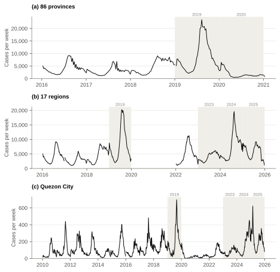
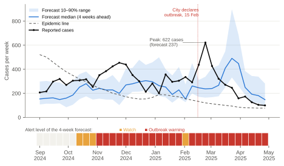
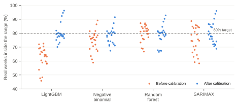
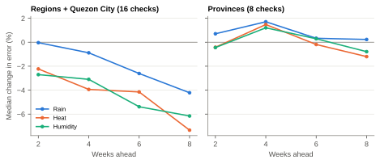

# EpiLag-PH: Forecasting weekly dengue cases two to eight weeks ahead, with calibrated ranges and tested alerts, for Philippine provinces, regions and Quezon City

**Jhezra Tolentino, Kishia Gaytano and Paul Dacalan**  
Team DiagNodes · Philippine Junior Data Science Challenge (PJDSC) 2026, final round · November 2026

---

## Abstract

Dengue is endemic in the Philippines. Local health offices usually learn that an outbreak has started from case reports, which arrive after people are already ill. A forecast made several weeks ahead would give these offices time to remove mosquito breeding sites and prepare clinics before cases peak. We built EpiLag-PH, a system that forecasts weekly reported dengue cases 2, 4, 6 and 8 weeks ahead for 86 provinces (data from 2016 to January 2021), and for 17 regions and Quezon City (data to December 2025). For each area and week, gradient-boosted quantile regression (LightGBM) gives a middle forecast and a 10–90% range. It works from recent cases, the time of year, population and lagged weather. The range is then widened by conformalized quantile regression so that it should contain about 80% of real weeks. Two alert levels compare the forecast with an epidemic line built from earlier years.

We tested the system on six years it had not seen: provinces in 2019 and 2020, and regions and Quezon City in 2019, 2023, 2024 and 2025. Each year was forecast only from earlier years. Four weeks ahead, the error was 18–32% lower than simply repeating this week's count in five of the six years, and 4% higher in 2023, an unusually flat year. It was 32–89% lower than repeating the count from the same week of the previous year. The calibrated ranges held 70–92% of weeks. The Watch alert caught 79–100% of outbreak starts, but 42–87% of its alerts were false alarms.

We put four forecasting methods through the same test, and LightGBM had the lowest error in 12 of 24 checks. Weather inputs improved the regional forecasts only at 6 and 8 weeks ahead, and did not improve the province forecasts. This agrees with recent work showing that climate variables do not always improve dengue forecasts. In Quezon City, the system was on Watch from a forecast made on 15 September 2024, five months before the city declared a dengue outbreak on 15 February 2025.

**Keywords:** dengue; forecasting; early warning; quantile regression; conformal prediction; gradient boosting; Philippines

---

## 1. Introduction

Dengue is a mosquito-borne viral disease that is endemic in the Philippines, with large seasonal epidemics in some years. The 2019 season was the largest in recent memory. On 6 August 2019, three weeks after a national dengue alert, the Department of Health (DOH) declared a national dengue epidemic. By then, 146,062 cases had been recorded since 1 January, 98% more than in the same period of 2018 (Andrade, 2019). Reported cases are also only part of the true burden. In a community in Cebu City, active surveillance found many more infections than the routine reporting system recorded (Undurraga et al., 2017).

Routine surveillance reacts to cases that have already happened. A person is infected, falls ill several days later, seeks care, is diagnosed and is then reported. By the time weekly counts rise above normal, transmission has already been under way for weeks. Clean-up drives, the removal of breeding sites and the preparation of clinics all take time to organise and to take effect. They are most useful before a peak, not after it. This gap between when an outbreak starts and when it shows up in the counts is the problem we address.

Dengue can be forecast because its main drivers act with a delay. Rain creates breeding sites, humidity and temperature govern how fast mosquitoes develop and how long they live, and the virus needs time to replicate inside the mosquito before it can be passed on. Studies in the Philippines and the wider region give the size and timing of these effects. In Manila, dengue followed rainfall over the previous six to seven weeks (Sumi et al., 2017). In Metro Manila, relative humidity was the most important weather factor, with its strongest link to dengue about four weeks later, and rainfall about five weeks later (Carvajal et al., 2018). In Davao, a week with about 32 mm of rain was linked to a 67% higher risk of dengue (Iguchi et al., 2018). Across 61 provinces, the risk from temperature followed an inverted U, rising to a peak near 27.5 °C and falling above it (Seposo et al., 2023). This lies within the 26–29 °C band where laboratory-based models place the peak of transmission (Mordecai et al., 2017). High relative humidity was the only factor linked to the second seasonal peak of dengue in the Philippines (Xu et al., 2020). Over longer periods, dengue cycles of two to five years across Southeast Asia move together with the El Niño–Southern Oscillation (ENSO), and epidemics spread between neighbouring provinces as travelling waves (van Panhuis et al., 2015). Elevation and population density have been linked to how often people are infected, but not to how many cases are reported (Sy et al., 2026).

Several studies have used these relationships to forecast dengue in the Philippines, each with a different scope. Olana et al. (2025) compared six methods for the national monthly total and found a neural network autoregression best. Carvajal et al. (2018) compared generalized additive models, SARIMAX, random forests and gradient boosting for Metro Manila using weekly weather, and found a random forest with lagged inputs best. Eligado et al. (2026) combined wavelets with statistical and neural network models to forecast weekly cases in Quezon City. Buczak et al. (2014) predicted, four weeks ahead, whether each province's incidence would be high or low. Elsewhere in the region, probabilistic forecasts with tested alerts exist at a monthly scale in Vietnam (Colón-González et al., 2021) and Brazil (Lowe et al., 2014), and weekly national forecasts with prediction intervals have been run in Singapore (Shi et al., 2016).

Two studies posted on arXiv shaped how we set up and report this work. Vásquez et al. (2019), a paper that is part of a master's thesis in public health at the University of Costa Rica, used generalized additive models and random forests to predict weekly dengue relative risk in five climatically different municipalities. They chose one lag for each climate variable in each municipality by cross-correlation, trained on 2007–2016 and tested on the 52 weeks of 2017. We follow the structure of their paper. We differ in three ways: we test on several held-out years rather than one, we compare against simple baselines, and we report ranges and alerts as well as point errors. Da Silva et al. (2024) asked directly whether climate variables improve dengue forecasts. They trained random forests on weekly data from three cities in Brazil, Peru and Colombia, with and without climate inputs. They found that "climate variables do not always help": in Natal, past cases alone gave the best forecast, and in the cities where climate did help, humidity was the most useful variable. As Section 4 shows, our results point the same way.

Taken together, this literature leaves a gap. None of the Philippine studies we reviewed combines all four of the following: weekly forecasts for many areas at several lead times; prediction ranges whose coverage is checked; alerts scored for both the outbreaks they catch and the false alarms they raise; and testing on several unseen years, including unusual ones. Several also compare their models only with other complex models, not with simple rules that a health office could apply by hand.

EpiLag-PH is designed to fill this gap. In this paper we describe the system and test it out of sample, asking four questions:

1. How accurate are the forecasts, compared with two simple baselines, on years the model has not seen?
2. Do the 10–90% ranges contain about 80% of real weeks, and do the alerts catch outbreak starts without too many false alarms?
3. Is gradient boosting a good choice, compared with three other common forecasting methods under the same test?
4. Which inputs carry the forecasts, and do weather and the other variables suggested by the literature improve them?

Section 2 describes the data, the model, the alert rules and the test design. Section 3 reports the results, Section 4 discusses why they came out as they did and what limits them, and Section 5 concludes.

---

## 2. Materials and methods

### 2.1 Study areas

EpiLag-PH works on two sets of areas, which we call panels because each is a set of areas observed every week. The **province panel** has 86 province-level units covering the whole country. To match the way cases are reported, independent cities are counted with the province around them, the National Capital Region (NCR) is split into its four districts, and Maguindanao is kept as one unit for 2016–2020. The **region and Quezon City panel** has the 17 administrative regions plus Quezon City, 18 areas in all. Quezon City is the country's most populous city, with 2,960,048 people in the 2020 census. It is part of NCR, so its cases are also counted in NCR's total. Across both panels, the system forecasts 104 areas every week.

The two panels cover different years (Figure 1). The province data end in January 2021, so the province panel is a historical replay. The regional data skip 2020 and 2021 but run to December 2025, so the region and Quezon City panel covers recent seasons, including the Quezon City outbreak of early 2025.

### 2.2 Data

#### 2.2.1 Dengue data

Province case counts come from the DOH Epidemiology Bureau's weekly dengue case and death records for 2016 to 2021, published on the Humanitarian Data Exchange (HDX) as part of the competition's official data catalogue. We use the weekly case counts from the first week of 2016 to January 2021, and do not use the death counts. Regional and Quezon City counts come from the UPRI-NOAH Dengue–Rainfall Dataset (Pelitro et al., 2026). It gives weekly cases for the 17 regions in 2016–2019 and 2022–2025, and for Quezon City from 2010 to 2025. All weeks are epidemiological weeks, labelled by their last day (a Sunday).

The province panel holds 209,544 reported cases in 2016, 154,155 in 2017, 250,783 in 2018, 441,902 in 2019 and 91,041 in 2020. The 2019 total was 76% above 2018's, and the 2020 total was 79% below 2019's.

#### 2.2.2 Climate data

For the provinces, daily rainfall, mean and maximum temperature, and mean relative humidity come from the ERA5 reanalysis (Hersbach et al., 2020) through the Open-Meteo archive service, taken at one point per province (its centre) from July 2015 to January 2021. Daily values are summed or averaged into epidemiological weeks. A heavy-rain day is a day with at least 50 mm of rain.

For the regions and Quezon City, the submitted model uses the weekly rainfall series that comes with the UPRI-NOAH dataset, which links the case counts to satellite rainfall estimates (Pelitro et al., 2026). The submitted regional model therefore has rain but no temperature or humidity. For the variable experiments in Section 2.8, we added daily ERA5 temperature and humidity at one population-weighted point per region and at the centre of Quezon City. We also added the Oceanic Niño Index (ONI), the standard ENSO index from the US National Oceanic and Atmospheric Administration's Climate Prediction Center.

#### 2.2.3 Population and geography

Area codes, centres and 2022 population counts come from the OCHA common operational datasets, which are based on Philippine Statistics Authority (PSA) data. Quezon City uses its 2020 census count. For the variable experiments only, we computed each province's elevation from the SRTM 90 m elevation model (NASA), sampled at 42,048 barangay centres through the OpenTopoData service.

**Table 1.** Data sources.

| Source | What it gives | Used for |
|---|---|---|
| DOH Epidemiology Bureau, via HDX | Weekly dengue cases, 2016–Jan 2021 | Province panel |
| UPRI-NOAH Dengue–Rainfall Dataset (Pelitro et al., 2026) | Weekly cases and rainfall; regions 2016–2019 and 2022–2025, Quezon City 2010–2025 | Region and Quezon City panel |
| ERA5 reanalysis (Hersbach et al., 2020), via Open-Meteo | Daily rain, temperature and humidity | Province weather; regional temperature and humidity in the experiments |
| NOAA Climate Prediction Center | Oceanic Niño Index | ENSO experiments |
| OCHA COD-AB and COD-PS (PSA-based) | Area codes, centres and population | Population input; neighbours |
| SRTM 90 m (NASA), via OpenTopoData | Elevation | Elevation experiments (provinces) |

### 2.3 Forecast target and inputs

For area $i$ and week $t$, let $c_{i,t}$ be the number of reported cases. The model works with the logarithm $y_{i,t} = \log(1 + c_{i,t})$. This puts small provinces and large regions on a comparable scale, and it turns proportional changes, which is how epidemics grow, into additive ones. For each lead time $h \in \lbrace 2, 4, 6, 8 \rbrace$ weeks, the target is $y_{i,t+h}$. Every input uses data up to week $t$ only, so a model trained on these rows can be run on the latest week to forecast $h$ weeks ahead.

The inputs fall into the groups in Table 2. The province panel has 38 inputs. The region and Quezon City panel has 26, because its submitted model has no temperature, humidity or heavy-rain inputs.

**Table 2.** Inputs to the submitted model.

| Group | Inputs | Provinces | Regions + QC |
|---|---|---|---|
| Recent cases | Log cases in each of the last 4 weeks; 4- and 12-week averages; trend over 3 weeks; the same week last year | 8 | 8 |
| Rain | Weekly rain this week and in each of the 11 weeks before; 4-, 8- and 12-week totals | 15 | 15 |
| Heavy rain | Days with at least 50 mm of rain in the last 8 weeks | 1 | – |
| Temperature | Mean temperature 0, 2, 4, 6 and 8 weeks back; highest daily maximum in the last 4 weeks | 6 | – |
| Humidity | Mean relative humidity 0, 2, 4, 6 and 8 weeks back | 5 | – |
| Season | Sine and cosine of the week of the year | 2 | 2 |
| Size | Log of population | 1 | 1 |
| **Total** | | **38** | **26** |

Vásquez et al. (2019) chose one lag for each climate variable in each area by cross-correlation, looking up to 30 weeks back. We take a different approach. We give the model a window of lags that covers the delays reported in the literature, and let it learn which ones matter. This avoids choosing lags on the same data that are later used to test the model. The window also reaches further than it first appears. The target lies $h$ weeks after week $t$, so a lag of $k$ weeks is $k + h$ weeks before the target. At 8 weeks ahead, for example, the rain inputs cover 8 to 19 weeks before the target week, and the temperature inputs 8 to 16 weeks. This reaches the 10-week temperature lag that Mordecai et al. (2017) used to validate their model, and most of the 13–18-week temperature lags found in Metro Manila (Carvajal et al., 2018).

### 2.4 Quantile gradient boosting

A single best guess is not enough for planning. A health office needs to know how high cases could plausibly go. We therefore forecast three quantiles of next weeks' cases: the 10th percentile, the median (50th) and the 90th percentile. The median is the middle forecast. The 10th and 90th percentiles bound a range that should contain the real count in 80% of weeks.

A model learns a quantile $\tau$ by minimising the pinball loss,

$$
\rho_\tau(u) = u \, \bigl( \tau - \mathbf{1}[u < 0] \bigr), \qquad u = y_{i,t+h} - \hat{q}_\tau(\mathbf{x}_{i,t}),
$$

where $\mathbf{x}_{i,t}$ is the vector of inputs for area $i$ in week $t$, $\hat{q}_\tau$ is the model's forecast of quantile $\tau$, and $\mathbf{1}[u<0]$ is 1 when the forecast was too high and 0 otherwise. The loss penalises a forecast that is too low by $\tau$ times the miss, and one that is too high by $(1-\tau)$ times the miss. For $\tau = 0.9$, under-forecasting costs nine times as much as over-forecasting, so the model learns to sit above about 90% of outcomes.

We fit each quantile with LightGBM (Ke et al., 2017), a fast implementation of gradient-boosted decision trees. Each model is a sum of 400 small trees, each fit to correct the errors of the ones before it, with a learning rate of 0.03, at most 31 leaves per tree, and at least 30 rows per leaf. Each tree sees a random 80% of the rows and 80% of the inputs. Separate models are fit for each quantile and each lead time, so each panel has 12 models. One set of models is shared by all areas in a panel, which lets small areas borrow strength from large ones. Missing inputs are left as they are, and LightGBM learns which way to send them at each split. Because the three quantiles are fit separately, they can occasionally cross, so we sort them to keep $\hat{q}_{0.1} \le \hat{q}_{0.5} \le \hat{q}_{0.9}$.

We chose boosted trees for three reasons. First, the drivers in Section 1 are non-linear: risk peaks at a middle temperature and falls on either side, and humidity acts through a threshold. Trees learn such shapes from the data without being told their form. Second, tree models have done well in dengue forecasting in Metro Manila and Bangladesh (Carvajal et al., 2018; Rahman et al., 2025), and LightGBM trains fast enough to refit every model for every test year (Ke et al., 2017). Third, each forecast can be explained with SHAP values (Lundberg & Lee, 2017), which split a forecast into the contribution of each input. The known weakness of trees is that they cannot forecast beyond the range of the data they were trained on (Olana et al., 2025). Section 4 shows where this cost us.

### 2.5 Calibrating the range

Quantile models are often overconfident on new data: their 10–90% range holds fewer than 80% of real outcomes, because each new year differs from the training years. We correct this with conformalized quantile regression (Romano et al., 2019). The idea is to measure how badly the range missed on a year the model did not see, and widen it by that amount.

For each test year and lead time, we fit a copy of the three quantile models on the training data minus its last 52 weeks, which we call the calibration year. We then forecast the calibration year. For each of its $n$ area-weeks $j$, we record how far the real value fell outside the range:

$$
E_j = \max \bigl\lbrace \hat{q}_{0.1}(\mathbf{x}_j) - y_j, \;\; y_j - \hat{q}_{0.9}(\mathbf{x}_j) \bigr\rbrace .
$$

$E_j$ is positive when the real value fell outside the range and negative when it fell inside. The margin $\hat{m}$ is the $\lceil 0.8(n+1) \rceil / n$ empirical quantile of $E_1, \dots, E_n$: the smallest widening that would have put about 80% of the calibration year inside the range. The calibrated range for a test week is

$$
\Bigl[ \, \hat{q}_{0.1}(\mathbf{x}) - \hat{m}, \;\; \hat{q}_{0.9}(\mathbf{x}) + \hat{m} \, \Bigr],
$$

converted back to cases with $\exp(\cdot) - 1$ and floored at zero. The margin is in log space, so it widens the range by a fixed proportion rather than a fixed number of cases. A negative margin narrows a range that was too wide. One margin is computed per panel, test year and lead time, and the same margin is added to both ends of the range. Section 3.9 shows that this symmetry matters.

### 2.6 Epidemic line and alert levels

An alert needs a line to compare the forecast with. For area $i$ and week of the year $w$, we define the epidemic line as

$$
L_{i,w} = \bar{c}_{i,w} + 2\, s_{i,w},
$$

where $\bar{c}_{i,w}$ and $s_{i,w}$ are the mean and standard deviation of the weekly counts in weeks $w-2$ to $w+2$ of all earlier years. The mean plus two standard deviations is a common surveillance rule. Using a five-week window gives each estimate five times as many past values, which smooths the line. When a test year is scored, the line is built from the years before it only, so the test year never helps set its own threshold.

We call the first week of a run of two or more weeks above the line an **outbreak start**. Requiring two weeks keeps a single noisy week from counting as an outbreak. Two alert levels compare a forecast with the line for its target week:

- **Watch:** the 90th-percentile forecast is above the line, so an outbreak is possible.
- **Outbreak warning:** the median forecast is above the line, so an outbreak is likely.

The app also shows two lower levels, "normal" and "above usual", where "usual" is the mean $\bar{c}_{i,w}$. We do not score those here.

We score each rule in two ways. An outbreak start is **caught** at lead time $h$ if the forecast made $h$ weeks before the start, for the start week itself, raised the alert. The **false-alarm share** is the share of all alert-weeks in which the real count turned out not to be above the line. This is a strict measure. An alert for the week just before a real crossing counts as false, even though a health office would find it useful.

### 2.7 Test design

Every result in this paper is out of sample. For each test year $Y$ and lead time $h$, the models are trained only on rows whose target week falls before 1 January of $Y$, and they then forecast every week of $Y$. This setup is often called an expanding-window backtest. It mimics how the system would have been used in real time: a model trained on everything known at the start of the year is used for the whole year. The calibration year of Section 2.5 is the last year of each training set.

The test years are 2019 and 2020 for the provinces, and 2019, 2023, 2024 and 2025 for the regions and Quezon City. That makes six panel-years. With four lead times each, there are **24 checks** in all. The province data end in January 2021, so 2020 is the last full province year. 2022, the first regional year after the 2020–2021 gap, is used only for training and calibration. Several of the test years are unusual: 2019 was a record epidemic, 2020 was disrupted by COVID-19, and 2023 was the flattest regional year in the data. Testing on them shows how the system behaves when a year departs from the past.

We compare every forecast with two simple baselines that a health office could compute by hand:

- **Persistence**, or "same as this week": the forecast for week $t+h$ is the count in week $t$.
- **Seasonal naive**, or "same week last year": the forecast for week $t+h$ is the count in the same week one year earlier.

Our main error measure is the mean absolute error (MAE) of the median forecast, in cases per area-week:

$$
\mathrm{MAE} = \frac{1}{N} \sum_{(i,t)} \bigl| \hat{c}_{i,t+h} - c_{i,t+h} \bigr|, \qquad \hat{c}_{i,t+h} = \exp\bigl(\hat{q}_{0.5}(\mathbf{x}_{i,t})\bigr) - 1 .
$$

We compare a model with a baseline through the relative change in error, $\mathrm{MAE}_{\text{model}} / \mathrm{MAE}_{\text{baseline}} - 1$. A value of −20% means the model's error was 20% lower than the baseline's. Raw errors cannot be compared across studies, because places, scales and case counts differ, so this relative measure is also how we compare our results with other work. All models and baselines are scored on the same rows: the weeks where both baselines also exist. **Coverage** is the share of real counts inside the calibrated 10–90% range. Its target is 80%.

### 2.8 Comparison methods

To test whether gradient boosting was a good choice, we ran three other common methods through exactly the same test, with the same training rows, the same calibration and the same scoring:

- **Negative binomial regression.** A log-linear count model of cases at $t+h$, with the same inputs. Missing inputs are filled with the training median, plus a flag for a missing count from last year. Inputs are standardised. The dispersion parameter comes from the auxiliary regression of Cameron and Trivedi (1990), fitted on a Poisson model. The forecast quantiles are those of the fitted negative binomial distribution.
- **Quantile regression forest** (Meinshausen, 2006). A random forest of 300 trees, with at least five rows per leaf and a third of the inputs tried at each split. Its quantiles come from the training outcomes that share a leaf with the forecast row.
- **SARIMAX.** One ARIMA(2,0,1) model per area on $\log(1 + c)$. Its regression inputs are a constant, two pairs of yearly Fourier terms, and the 4-week rain total, plus temperature and humidity for provinces, all taken $h$ weeks before the target week so that they are known at forecast time. We chose the order by mean AIC on data up to 2018 for Quezon City and six provinces: (2,0,1) scored 250.8, against 253.3 for (2,0,0), 286.6 for (1,0,1) and 325.0 for (1,0,0). Missing weeks are handled by the Kalman filter, and the quantiles are those of the normal $h$-step forecast.

We also scored an equal-weight **average of the four methods**. Each method's calibrated 10th, 50th and 90th percentiles are averaged in log space, quantile by quantile, which is known as quantile averaging (Lichtendahl et al., 2013). Nothing is refit, no weights are tuned, and the average gets no calibration of its own.

As a check on the test harness, LightGBM run through it reproduces the submitted model's errors, coverage and alert counts exactly.

### 2.9 Variable experiments

To learn which inputs matter, we built a larger **research table**. For the regions and Quezon City, it adds the ERA5 temperature and humidity inputs that the provinces already have. For both panels, it adds four heat measures and two ENSO inputs:

- **Heat:** days with mean temperature between 26 and 29 °C over the last four weeks, and the same four weeks earlier; days with a maximum of at least 34 °C; and the four-week mean heat index.
- **ENSO:** the Oceanic Niño Index for the three-month season centred two months before week $t$, which is already published at forecast time, and the same index three months earlier.

For the provinces only, the research table also adds mean elevation, the share of land below 100 m, and the log of population density. With only 18 regional areas, a fixed value per area would have just 18 distinct values and would act as a label for the area rather than a measured effect, so we did not add these to the regional panel.

We grouped the inputs (recent cases, season, rain, heat, humidity, ENSO, elevation and population) and ran two tests for each group. In the **add** test, the group is added to recent cases plus season, and the result is compared with recent cases plus season alone. In the **drop** test, the group is removed from the full research table, and the result is compared with the full table. A group that helps in the add test but not the drop test is useful on its own but redundant with the other groups.

From the literature review, we then built three groups of **proposed variables**, using only data before 2019 to set their thresholds:

- **Neighbours' cases:** the pooled incidence (log cases per 100,000) of the nearest areas this week, its four-week mean and its change over three weeks. The nearest areas are the four closest provinces, or the three closest areas in the regional panel, by distance between centres. This follows the travelling waves of van Panhuis et al. (2015) and the adjacent-province inputs of Buczak et al. (2014).
- **Heatwave days:** days in a run of two or more days with a maximum temperature above the area's own 95th percentile, following Ith et al. (2025), counted over four weeks and lagged by four and eight weeks.
- **Rain anomaly:** the 12-week rain total as a z-score against the same time of year in the area's own past. This stands in for the drought index used by Ith et al. (2025), which is not available per area.

We also tested rain totals 12–15, 16–19 and 20–23 weeks back, to see whether rain effects reach further than the 0–11-week window. Each proposed group was added to recent cases plus season and to the full research table.

To see what the model pays attention to, we fitted the median model on all usable rows and computed mean absolute SHAP values (Lundberg & Lee, 2017) over a fixed sample of 4,000 area-weeks. A group's share of attention is its inputs' summed mean absolute SHAP value divided by the total. Finally, we scored several candidate sets of inputs on every measure (error, coverage and both alert rules) to choose final variables. Our rule was to keep only changes that lowered the error without losing outbreak starts on either alert rule.

All variable experiments used LightGBM through the same test harness.

---

## 3. Results

### 3.1 The data

Figure 1 shows the weekly totals for each panel. The province data are dominated by the 2019 epidemic, which peaked at more than 23,000 cases a week across the 86 provinces. Every one of the 86 provinces reported fewer cases in 2020 than in 2019. The 2020 drop began in late March. In weeks 1–12 of 2020, the national total ran at 0.8 to 1.8 times the 2016–2018 average for the same week, but it then fell to 0.55 times by week 15, 0.34 times by week 21, and about 0.2 times from week 31 onward. The timing fits a break in transmission or in reporting around the COVID-19 lockdown, but these data cannot tell the two apart.

The regional series show large epidemics in 2019 and 2024, a moderate season in 2022, and an unusually flat 2023. Across the 17 regions, 2023 had the lowest median ratio of peak to mean weekly cases of any year (1.94, against 2.14–3.00 in other years), and the lowest median volatility of four-week changes in log cases (0.40, against 0.41–0.57). Quezon City's series runs from 2010 and ends with the record early-year outbreak of 2024–25.

**Figure 1.** Weekly reported dengue cases. (a) Sum over the 86 province-level units, 2016 to January 2021. (b) Sum over the 17 regions; the data skip 2020 and 2021. (c) Quezon City, 2010–2025. Shaded bands mark the test years. Each test year is forecast only from the years before it.

### 3.2 Accuracy of the submitted model

Table 3 gives the submitted model's results four weeks ahead in each test year. In five of the six panel-years, its error was 18–32% lower than persistence. The exception was the regional panel in 2023, where it was 4% higher: 58.0 cases per area-week, against 55.6 for persistence. Against the seasonal naive baseline, the error was lower in every year, by 32% to 89%. The 89% figure for the provinces in 2020 should not be read as typical skill. It reflects how badly "same week last year" fails in a break year, because it copies the 2019 epidemic into a year whose counts collapsed (Figure 1a).

**Table 3.** The submitted model four weeks ahead, by test year.

| Panel and test year | Error (MAE, cases per area-week) | Change vs persistence | Change vs seasonal naive | Weeks inside the 10–90% range | Outbreak starts | Caught by Watch | Watch false alarms | Caught by Outbreak warning | Outbreak warning false alarms |
|---|---|---|---|---|---|---|---|---|---|
| Provinces 2019 | 41.5 | −22% | −36% | 77% | 211 | 179 (87%) | 46% | 84 (41%) | 25% |
| Provinces 2020 | 9.7 | −20% | −89% | 79% | 23 | 19 (83%) | 87% | 12 (52%) | 64% |
| Regions + QC 2019 | 174.3 | −18% | −32% | 70% | 38 | 30 (79%) | 42% | 15 (39%) | 24% |
| Regions + QC 2023 | 58.0 | +4% | −63% | 92% | 9 | 9 (100%) | 63% | 3 (33%) | 22% |
| Regions + QC 2024 | 101.2 | −32% | −56% | 80% | 20 | 16 (80%) | 42% | 7 (35%) | 9% |
| Regions + QC 2025 | 86.0 | −20% | −70% | 78% | 14 | 14 (100%) | 54% | 7 (50%) | 26% |

*Note.* Shares caught are of the outbreak starts that had a forecast for their week. For the provinces in 2019, 206 of the 211 starts did. A false alarm is an alert-week whose real count was not above the epidemic line.

The advantage over persistence grew with lead time. For the provinces in 2019, the error was 5% lower than persistence at 2 weeks ahead, 22% lower at 4 weeks, 31% lower at 6 weeks and 37% lower at 8 weeks. This is expected. Over two weeks, case counts rarely move far, so repeating this week's count is hard to beat. Over eight weeks they can change a great deal, and a model that knows the season and recent trend has more to add.

### 3.3 Ranges and alerts

After calibration, the 10–90% ranges held 70–92% of real weeks four weeks ahead (Table 3), and 70–96% across all 24 checks, with a mean of 80%, which is the target. Before calibration, the same ranges held only 46–73% of real weeks (Figure 3). Calibration was therefore essential. The worst year before calibration was the regional 2019 epidemic, at 48%, because that season rose far above anything in the training years. The one year where calibration overshot was 2023, at 92%. Section 3.9 explains why.

The two alert levels behave as designed: one is sensitive and the other strict. Four weeks ahead, Watch caught 79–100% of outbreak starts, but 42–63% of its alert-weeks in most years, and 87% for the provinces in 2020, were false alarms. Outbreak warning caught fewer starts, 33–52%, with fewer false alarms in most years: 9–26%, rising to 64% in 2020. The high false-alarm share in 2020 follows from the collapse in reports. The epidemic line was built from years that included the 2019 epidemic, while 2020 counts were very low, so there were only 23 outbreak starts to catch and many alerts went unconfirmed. In a replay of the 2019 season from the week ending 2 June 2019, the model flagged 30 of the 32 provinces that later crossed the epidemic line four weeks ahead, and all 11 regions or Quezon City that did.

### 3.4 A worked example: Quezon City, 2024–25

Figure 2 follows the Quezon City outbreak of 2024–25 week by week. It shows the four-week-ahead forecasts against the real counts and the epidemic line. Real counts first crossed the epidemic line in the week ending 20 October 2024, dipped just below it the next week, and then stayed above it for 27 weeks, from the week ending 3 November 2024 to the week ending 4 May 2025. They peaked at 622 cases in the week ending 23 February 2025, about five times the epidemic line for that week, which was about 120 cases.

The forecasts moved to Watch with the one made on 15 September 2024, for the week ending 13 October. They stayed on Watch every week after that, through the peak. From the forecast made on 6 October 2024 (for the week ending 3 November), the median was also above the line: an Outbreak warning. All forecasts after that were Outbreak warnings except one. The city government declared a dengue outbreak on 15 February 2025 (ABS-CBN News, 2025), five months after the first Watch.

The example also shows the system's main limit. It called the outbreak, but not its height. For the peak week, the forecast made four weeks earlier was 237 cases, with a likely range of 164–338. The real count of 622 was far above that range. This is the extrapolation limit of tree models discussed in Section 4.2: the early-2025 season was larger than anything in Quezon City's training years for that time of year.

**Figure 2.** Quezon City, September 2024 to April 2025. The black line is reported weekly cases. The blue line and band are the median and calibrated 10–90% range of the forecast made four weeks before each week. The dashed line is the epidemic line from earlier years. The strip below the chart shows each week's alert level from the four-week forecast. Forecasts for 2024 weeks come from the model trained on data up to 2023, and forecasts for 2025 weeks from the model trained on data up to 2024.

### 3.5 Four methods on the same test

Table 4 compares the four methods and their average over the 24 checks. LightGBM had the lowest error of the four in 12 checks, negative binomial regression in 7, SARIMAX in 5, and the quantile random forest in none. No method won everywhere.

**Table 4.** Four forecasting methods and their average, on the same 24 checks.

| | LightGBM (submitted) | Negative binomial | Random forest | SARIMAX | Average of the four |
|---|---|---|---|---|---|
| Lowest error of the four methods (checks) | 12 | 7 | 0 | 5 | – |
| Lower error than persistence (of 24) | 19 | 23 | 19 | 18 | 24 |
| Lower error than seasonal naive (of 24) | 24 | 24 | 24 | 24 | 24 |
| Median change in error vs LightGBM, at 2 / 4 / 6 / 8 weeks | – | +2.1 / +4.5 / +9.6 / +11.9% | +0.5 / +2.6 / +4.2 / +2.9% | +4.5 / +5.8 / +1.8 / +0.1% | −4.1 / −3.6 / −2.2 / −1.7% |
| Weeks inside the range before calibration (lowest–highest) | 46–73% | 59–89% | 67–87% | 58–89% | – |
| Weeks inside the range after calibration (lowest–highest) | 70–96% | 67–91% | 67–93% | 69–96% | 73–97% |
| Outbreak starts caught by Watch (of 1,260) | 1,049 (83%) | 1,052 (83%) | 1,036 (82%) | 1,102 (87%) | 1,097 (87%) |
| Outbreak starts caught by Outbreak warning (of 1,260) | 458 (36%) | 465 (37%) | 473 (38%) | 218 (17%) | 383 (30%) |

*Note.* The 315 outbreak starts in the six test years are each scored at four lead times, giving 1,260. A positive change in error means the method's error was higher than LightGBM's.

The methods won in different kinds of years. **Negative binomial regression** had the lowest error in the regional 2023 test at every lead time (2–19% below LightGBM), in regional 2019 at 2 and 4 weeks ahead (31% and 14% below), and in provinces 2019 at 2 weeks (5% below). It did worst in provinces 2020 (15–29% above LightGBM) and regional 2024 (14–22% above). It was also the only method that beat persistence in regional 2023. **SARIMAX** had the lowest error in regional 2019 at 6 and 8 weeks and in 2025 at 4–8 weeks. **LightGBM** won everything else, including every province check at 4 weeks or more and every lead time of regional 2024, a large season that kept to its usual timing. The **random forest** never won, but stayed close to LightGBM, with a median error 2.6% higher and a range from 2.7% lower to 9.4% higher.

The methods also differed in how honest their raw ranges were. Before calibration, LightGBM's range was the narrowest of the four: it held 46–73% of weeks, with a median of 64%. The random forest's was the most honest, with a median of 81%. After calibration, all four held close to 80% on average (Figure 3).

On the alert rules, SARIMAX caught the most outbreak starts on Watch (87%) but by far the fewest on Outbreak warning (17%). Its Outbreak warning catches fell with lead time, from 63 of 315 starts at 2 weeks to 40 at 8 weeks, while its Watch catches did not (262–283 at every lead time). Its median forecast was not biased low overall: the median log error ranged from −0.06 to +0.03. Why its median rarely crosses the epidemic line early remains an open question (Section 4.4).

The equal **average of the four methods** had a lower error than LightGBM in 17 of 24 checks, with a median change of −2.6% (range −18% to +4%). It beat persistence in all 24 checks, against 19 for LightGBM. Against the four single methods, it had the lowest error in 11 of 24 checks. It did worse than LightGBM in provinces 2020 (+2% to +4%) and regional 2024 (0% to +4%). The cost of the average was on Outbreak warning: it caught 30% of outbreak starts, against 36% for LightGBM. Averaging only LightGBM and negative binomial regression gained less, with a median of −0.6% and a worst case of +9.8%.

**Figure 3.** Share of real weeks inside the 10–90% range before (orange) and after (blue) calibration, for each method. Each dot is one of the 24 checks. The dashed line is the 80% target.

### 3.6 What the inputs contribute

**Recent cases carry the forecasts.** Removing the recent-case inputs from the full research table made the error 21% to 303% worse in every check. In the SHAP analysis, recent cases took 48–76% of the model's attention. This share was highest at 2 weeks ahead and fell as the lead time grew. The time of year came next with 7–13%, then rain, with 8–17% for the regions and 5–8% for the provinces.

**Weather helps the regional forecasts, and more so further ahead.** Table 5 gives the add test for each input group. For the regions and Quezon City, each weather group improved on recent cases plus season in most checks: humidity in 15 of 16, heat in 14 and rain in 12. The gain grew steadily with lead time (Figure 4). Heat, for example, lowered the error by a median of 2.2% at 2 weeks ahead and by 7.3% at 8 weeks. The submitted regional model, whose only weather input is rain, shows the same pattern. Removing its weather changed the error by a median of +0.5%, 0.0%, −2.2% and −4.9% at 2, 4, 6 and 8 weeks, which means weather helped only at the two longer leads. Over the same leads, rain's share of the model's attention rose from 11% to 18%, 22% and 24%.

In the drop test, removing any single weather group from the full regional table cost almost nothing (median changes of 0.0% to +0.5%). Rain, heat and humidity follow the same yearly cycle, so when one is removed, the others cover for it. This shows that the three groups overlap, not that weather has no effect.

**Weather does not help the province forecasts.** For the provinces, no weather group improved the forecasts in more than half the checks, and the median changes were all close to zero (Table 5). Removing all weather from the submitted province model changed the error by +0.6%, +1.3%, −0.4% and +0.7% at 2, 4, 6 and 8 weeks. The model still gave weather 9–18% of its attention, rising with lead time. It used the weather inputs without becoming more accurate.

**Table 5.** Effect of adding each input group to recent cases plus season.

| Group | Regions + QC: checks improved (of 16) | Regions + QC: median change at 2 / 4 / 6 / 8 weeks | Provinces: checks improved (of 8) | Provinces: median change |
|---|---|---|---|---|
| Rain | 12 | 0.0 / −0.9 / −2.6 / −4.2% | 2 | +0.7% |
| Heat | 14 | −2.2 / −3.9 / −4.1 / −7.3% | 3 | +0.3% |
| Humidity | 15 | −2.7 / −3.1 / −5.4 / −6.2% | 4 | +0.1% |
| ENSO | 8 | +0.6 / −1.8 / −3.3 / −4.4% | 2 | +2.3% |
| Elevation | not tested | – | 7 | −1.9% |
| Population | 15 | −2.2 / −2.5 / −6.2 / −9.4% | 4 | 0.0% |

*Note.* Negative changes mean lower error. Population is a fixed value for each area. For the 18 regional areas it acts as a label for the area (Section 4.3).

**Figure 4.** Median change in error when each weather group is added to recent cases plus season, by lead time. Values below zero mean the group lowered the error. Each point is the median over the test years at that lead time: four for the regions and Quezon City, two for the provinces.

**The weather gain depends on the year.** For the regional panel, the effect of the submitted model's weather varied widely by year. In 2024, it lowered the error by 9.1% at 4 weeks and 11.3% at 6 weeks. In 2023 it raised the error at 6 and 8 weeks, by 8.2% and 12.2%. In 2019 and 2025, it helped only at 6–8 weeks, by 2–6%. We expected weather to help most in unusual years, but the opposite held. 2024 was the most ordinary of the four years: its wet-season rain was within 10% of the areas' other years, and its case curve followed the usual season most closely (median correlation 0.86 with the usual seasonal shape). In contrast, 2025 was the wettest year (+33% wet-season rain) and had the most unusual case curve (correlation 0.41), and 2019 was the driest (−21%). Weather helped little in both.

**ENSO, elevation and population.** The ENSO index made the province forecasts worse in every check. Removing it from the full province table lowered the error in all 8 checks, by a median of 1.6%. For the regions it was mixed, helping in 8 of 16 checks. Even so, ENSO took 4–11% of the province model's attention, despite making its forecasts worse. Elevation helped the provinces when added alone, in 7 of 8 checks (−1.9%, and −4.7% at 8 weeks), but not inside the full table. Population helped the regional panel in 15 of 16 checks. Because it is a fixed value for each of only 18 areas, we read this as the model using population to tell the areas apart, not as evidence that population drives dengue.

### 3.7 Variables proposed by the literature

Of the three proposed groups, only **neighbours' cases** added anything to the full research table, and only for the provinces. There it lowered the error in all 8 checks, by a median of 2.8% (range −4.5% to −1.1%). For the regional panel, neighbours' cases helped a little on top of recent cases plus season (11 of 16 checks, −1.8%), but not on top of the research table (9 of 16, −0.1%).

**Heatwave days** and the **rain anomaly** each helped the regional panel slightly when added to recent cases plus season (9 and 10 of 16 checks, −0.8% and −1.3%), but neither added anything on top of the research table. For the provinces, both made the forecasts worse when added to recent cases plus season. The rain anomaly was worse by 2–12% in 2020, the year when reports collapsed for reasons unrelated to weather.

**Rain 12–23 weeks back** did not improve the forecasts. It lowered the error in only 9 of 24 checks, with a median change of +0.3% (range −2.7% to +4.8%), and it cost a few outbreak starts on Watch: 2 for the regions and 8 for the provinces. Yet the model did use it. At 6 and 8 weeks ahead in the regional panel, rain 12–15 weeks back took more attention than any other four-week block of rain (3.5% and 4.3% of all attention). In the submitted model, rain's attention also peaked at the longest lag available, 10–11 weeks back, in three of the four lead times. Section 4.3 discusses why the model pays attention to these long lags without gaining from them.

### 3.8 Final variable sets

Table 6 scores the candidate sets of inputs against the submitted ("live") inputs on every measure. No set won on every measure. For the regions and Quezon City, the sets that lowered the error most, namely the full research table and the average of the four methods, also caught the fewest outbreak starts on Outbreak warning (89 and 80, against 101 for the live set).

**Table 6.** Candidate input sets against the submitted inputs.

| Panel | Set | Checks better than live | Median change in error (worst) | Beat persistence | Mean coverage (lowest–highest) | Watch catches | Outbreak warning catches |
|---|---|---|---|---|---|---|---|
| Regions + QC (16 checks, 324 starts) | Live (submitted) | – | 0 | 11 | 81% (70–96%) | 270 | 101 |
| | + heat, humidity, ENSO (research table) | 11 | −2.4% (+2.5%) | 15 | 79% (68–94%) | 265 | 89 |
| | + heat, humidity, without ENSO | 13 | −0.9% (+2.1%) | 13 | 81% (73–95%) | 264 | 99 |
| | Average of the four methods | 13 | −3.4% (+4.4%) | 16 | 83% (75–97%) | 277 | 80 |
| Provinces (8 checks, 936 starts) | Live (submitted) | – | 0 | 8 | 78% (76–80%) | 779 | 357 |
| | + neighbours' cases | 8 | −2.4% (−0.5%) | 8 | 79% (76–80%) | 786 | 374 |
| | + elevation, density | 3 | +0.1% (+0.6%) | 8 | 78% (76–80%) | 783 | 340 |
| | Research table | 0 | +1.2% (+9.5%) | 8 | 79% (75–82%) | 801 | 337 |
| | Research table without ENSO | 4 | 0.0% (+1.6%) | 8 | 78% (74–79%) | 782 | 343 |
| | Research table without ENSO, + neighbours | 8 | −2.0% (−0.6%) | 8 | 79% (75–80%) | 789 | 355 |
| | Average of the four methods | 4 | +0.4% (+4.2%) | 8 | 79% (73–85%) | 820 | 303 |

Applying our rule (lower error without losing outbreak starts on either alert), we chose:

- **Provinces:** the live inputs plus neighbours' cases. This was the only province set that was better in all 8 checks, and it also caught more outbreak starts on both rules (7 more on Watch, 17 more on Outbreak warning).
- **Regions and Quezon City:** the live inputs plus heat and humidity, without ENSO. This gave a small, steady gain (13 of 16 checks, with a worst case of +2.1%) and kept Outbreak warning nearly level (99 catches against 101). Adding ENSO would have lowered the error further, mostly in 2023 (by 5–14%), but it cost 10 Outbreak warning catches, and the province results suggest ENSO may be acting as a label for the year (Section 4.3).

Together, against the live inputs over all 24 checks, the final sets lowered the error in 21 checks, with a median change of −1.4% (range −6.1% to +2.1%). By lead time, the median changes were −1.8%, −2.6%, −0.9% and −1.1%. They were worse in three checks: regional 2019 at 2 and 4 weeks (+2.1% and +0.4%) and regional 2025 at 6 weeks (+1.6%). They beat persistence in 21 of 24 checks, against 19, and the two new wins were regional 2023 at 2 and 4 weeks, the year the live model lost. Coverage stayed at 80% on average. Watch caught 1,050 outbreak starts against 1,049, and Outbreak warning caught 473 against 458, with unchanged false-alarm shares (58% and 30%).

These choices were made after seeing the test years, so these gains are optimistic (Section 4.6). The submitted model, whose results are in Sections 3.2–3.4, is unchanged.

### 3.9 Why the 2023 range was too wide

In 2023 the regional range held 92% of weeks against an 80% target (Table 3). This was not a problem with the model's raw range. Before calibration, it held 68% of 2023 weeks, close to 2024 (69%) and 2025 (64%). The difference came from the calibration margin. Calibrated on 2022, the 2023 margin was 0.227 in log space at 4 weeks ahead, against 0.094 and 0.097 for 2024 and 2025 (Table 7). At 8 weeks it was 0.476, 2.6–2.7 times the 2024 and 2025 margins. The median width of the 2023 range in log space was 1.07, against 0.79 and 0.82 in 2024 and 2025.

**Table 7.** The calibration year behind each regional test year, four weeks ahead.

| Calibration year (test year) | Median log error of the calibration model | Weeks above its 90th percentile | Weeks below its 10th percentile | Margin | Test-year coverage before calibration | Test-year coverage after calibration |
|---|---|---|---|---|---|---|
| 2018 (2019) | −0.16 | 36% | 8% | 0.176 | 48% | 70% |
| 2022 (2023) | −0.20 | 38% | 9% | 0.227 | 68% | 92% |
| 2023 (2024) | −0.07 | 20% | 12% | 0.094 | 69% | 80% |
| 2024 (2025) | −0.07 | 22% | 8% | 0.097 | 64% | 78% |

*Note.* The calibration model is the copy fitted without the last training year (Section 2.5). A negative median log error means it forecast too low.

We tested two explanations and ruled both out. First, 2022 was not an unusual year. Its regional case level shifted from earlier years by a median of 0.51 in log terms, which is in the middle of the range (2019: 0.82; 2024: 0.66; 2023: 0.35), and its wet-season rain was within 1% of normal. Second, the gap in the data was not the cause. Because the regional series skip 2020–2021, the input "same week last year" is missing in 2022 for 17 of the 18 areas. We reran the regional backtest twice: once filling the gap with the same week three years earlier, and once dropping the input. The 2023 margin stayed at 0.216 and 0.228, and the 2023 range still held 91.5% and 92.4%. Restricting the calibration to 2022 weeks that had their 4- and 12-week averages (766 of 851 weeks) also left the margin at 0.224.

What the margin does track is how the calibration model forecast its own year (Table 7). The model fitted without 2022 forecast 2022 about 18% too low at 4 weeks ahead (a median log error of −0.20), and the shortfall grew to −0.41 at 8 weeks. Its misses were one-sided: 38% of weeks fell above its 90th percentile, but only 9% below its 10th. The calibration step adds a single margin to both ends of the range. As a result, a calibration model that ran low widened the bottom of the 2023 range as well as the top, even though nothing had been missed at the bottom. The 2023 test model itself was not running low, so the full margin pushed its coverage from 68% to 92%. The 2019 test year had the same calibration pattern (a margin of 0.176 from a low-running 2018 model), but the record epidemic used up the extra width, and its range held only 70%.

---

## 4. Discussion

### 4.1 Principal findings

EpiLag-PH forecast weekly reported dengue cases with a lower error than both simple baselines in five of the six unseen test years at four weeks ahead. Its calibrated ranges held about 80% of real weeks on average, and its Watch alert caught most outbreak starts. Among four forecasting methods put through the same test, gradient boosting won most often, but not everywhere. Recent case counts carried most of every forecast. Weather helped the regional forecasts at longer leads and did not help the province forecasts. The losses have specific causes, which we discuss below, and the research found a slightly better set of inputs whose gains should be confirmed on a new season.

### 4.2 Where the model lost, and why

The model lost to persistence in two kinds of situation. The first was **record years at short range**. In the regional 2019 test, it was 18% worse than persistence at 2 weeks ahead. The 2019 regional curve rose higher than anything in 2016–2018. Its level shift from earlier years (0.82 in log terms) was the largest of any year. A tree model cannot forecast beyond the range of the values it was trained on (Olana et al., 2025), so its median was capped below the actual rise. Negative binomial regression, a log-linear model, has no such ceiling: a rising trend in log cases carries straight into its forecast, which is why it won regional 2019 at 2 and 4 weeks ahead. The Quezon City peak of February 2025 (Section 3.4) shows the same limit. The model saw the outbreak coming, but its median stayed below the record count.

The second was the **flat year 2023**, the regional year with the lowest ratio of peak to mean cases and the lowest four-week volatility of the eight years in the data. In a year where the case level barely moves over four weeks, "same as this week" is a very strong forecast, and the 2.4-case gap (4%) is small next to persistence's own error of 55.6. Negative binomial regression did better here because, when nothing changes, its forecast stays close to this week's count. Its error was 90–99% of persistence's. Weather also hurt in 2023 at longer leads. Rain was close to normal, but cases stayed flat, so forecasts that leaned on weather called for a rise that did not come. One possible reason is immunity built up during the 2022 season, but these data cannot test it.

The comparison of methods points the same way. The methods fail in different years. Negative binomial regression struggled in 2024, LightGBM in 2019 and 2023, and SARIMAX at short leads. As a result, an average of the four cancelled part of each one's misses and beat persistence in all 24 checks. Combining models has helped elsewhere too: in Vietnam, a superensemble of dengue models beat a seasonal-average baseline one to three months ahead and detected more outbreaks (Colón-González et al., 2021).

### 4.3 What the inputs tell us

**Weather helps more further ahead.** The published delays between weather and dengue are about 4 weeks for humidity (Carvajal et al., 2018; Shi et al., 2016), 5–7 weeks for rain (Sumi et al., 2017; Carvajal et al., 2018), and 10–18 weeks for temperature (Mordecai et al., 2017; Carvajal et al., 2018). A forecast made 2 weeks ahead is made after most of the relevant weather has already shown up in the case counts, so recent cases already carry its signal. A forecast made 8 weeks ahead is made before that has happened, so the weather inputs carry information that the case counts do not yet show. This is why both the gain from weather and the attention the model gives it grew steadily with lead time in the regional panel (Figure 4). It also explains why recent cases dominate the attention at short leads.

**Climate variables do not always help.** Our province result is a clear example of the pattern reported by da Silva et al. (2024). In Natal, Brazil, they found that a random forest forecast best from past cases alone, and that adding climate variables did not improve it. Our province model, too, gave weather a growing share of its attention without becoming more accurate. Three causes are likely, and these data cannot separate them. First, both province test years were unusual. One was a record epidemic and the other a collapse in reports, and in such years recent cases dominate. Second, province weather is taken at a single point per province, which is a noisy summary of a large and often mountainous area. Third, the provinces had only three years of training data before 2019, while the published weather effects were estimated from about ten years of data (Seposo et al., 2023; Xu et al., 2020). Da Silva et al. (2024) also found that humidity was the most useful climate variable in the cities where climate did help. In our regional panel, humidity was likewise the most consistent weather group, helping in 15 of 16 checks. This agrees with the Philippine evidence that humidity is the top weather factor in Metro Manila (Carvajal et al., 2018) and the factor linked to the second seasonal peak (Xu et al., 2020). Vásquez et al. (2019) did not compare their models with and without climate inputs, so their results cannot tell whether climate improved their forecasts. Our design includes this comparison, and the answer depends on the panel and the lead time.

**Weather does not help most in unusual years.** We expected weather to matter most when a year departs from the usual season, but it helped most in 2024, the most ordinary year. Two explanations fit. First, a very wet or very dry year lies outside the weather the model saw in training, the same extrapolation limit as in Section 4.2. Second, more rain does not always mean more dengue. Across Southeast Asia, extremely wet conditions lowered dengue risk while drought raised it (Ith et al., 2025). Weather seems to help most in sizing a season that keeps to its usual timing, as in 2024.

**Long rain lags mark the season, not a delayed effect.** The model paid attention to rain 10–15 weeks back but did not become more accurate when given longer rain windows. The rain effects reported in the Philippines are much shorter, about 5–7 weeks (Carvajal et al., 2018; Sumi et al., 2017). The more likely reading is that rain three to four months before the forecast week tells the model where the year is in the rainy season. The time-of-year inputs and the shorter rain lags already carry that information.

**ENSO acts as a label for the year.** The ENSO evidence concerns cycles of two to five years (van Panhuis et al., 2015). The province data span five years, which is about one cycle. With so few cycles, the model can use the ENSO index to recognise individual years, which works in training but fails on a new year. This would explain why ENSO made every province forecast worse while still drawing 4–11% of the attention. Quezon City has 16 years of data, more than enough for several cycles, which may be why ENSO's effect on the regional panel was mixed rather than negative.

**Elevation and population.** Elevation helped the provinces when added alone but not inside the full table, which matches Sy et al. (2026): elevation is linked to how often people are infected, but not to how many cases are reported. A model that already knows each province's recent cases has little to learn from a fixed value per province. Elevation's gain alone probably comes from standing in for climate (lowland areas are warmer) and for urbanisation, which the weather groups carry in the full table. Population helped the regional panel for a modelling reason rather than an epidemiological one. With only 18 areas, a fixed value per area lets the pooled model learn each area's own level.

**Neighbours' cases help provinces.** Dengue spreads between nearby areas (van Panhuis et al., 2015), so a province's neighbours often rise before it does. Their reports this week are an early signal that the province's own recent cases do not yet show. This helped the provinces more than the evidence led us to expect. It did not help the regional panel, whose 17 regions are large, far apart and already sum many neighbouring provinces within themselves.

### 4.4 Ranges, calibration and alerts

Before calibration, LightGBM's ranges were the narrowest of the four methods. Part of the reason is that each new year differs from the training years: the worst raw coverage was in the record year 2019. That does not explain why LightGBM was narrower than the other methods on the same years. A likely second cause lies in the model itself. Its 400 boosted trees fit the training years closely, so the training errors that set its quantiles are too small. The random forest takes its ranges from real training outcomes in the same leaf, which gives wider and more honest raw ranges. We have not tested this explanation. It could be checked by measuring raw coverage on the training years, or by refitting with fewer trees or larger leaves.

Conformal calibration fixed the coverage on average, but Section 3.9 shows its weakness. It rests on a single year and adds a single margin to both ends of the range. When the calibration model runs low in its year, the margin widens both ends of the next year's range, though only the top had missed. Romano et al. (2019) describe a version of conformalized quantile regression with separate margins for the lower and upper ends. That version, or calibration over more than one year, should prevent the over-wide 2023 range. We have not tested either.

The two alert levels trade sensitivity against precision. Watch catches most outbreak starts, but about half its alert-weeks are false alarms. Outbreak warning raises fewer false alarms but catches only a third to a half of starts. For a health office, the levels suggest different responses. Watch is a prompt to check local reports and prepare. Outbreak warning is a prompt to act. Our false-alarm measure is strict, because it counts an alert for the week before a real crossing as false. For SARIMAX, which caught the most starts on Watch but the fewest on Outbreak warning, one explanation is that its forecast is pulled back toward the seasonal average as the lead time grows. Its median then stays under the epidemic line during an outbreak, while its widening range pushes the 90th percentile over the line. The fall in its Outbreak warning catches with lead time supports this, but we have not tested it directly.

### 4.5 Comparison with other work

Errors cannot be compared directly across studies, because places, scales and case counts differ. What can be compared is study design. Among the Philippine forecasting studies we reviewed, Olana et al. (2025) forecast the national total by month, Carvajal et al. (2018) forecast one metro area with a single test year, and Eligado et al. (2026) forecast one city. Buczak et al. (2014) forecast provinces weekly at a fixed lead of four weeks, as a high-or-low classifier. EpiLag-PH forecasts 104 areas weekly at four lead times. We did not find calibrated ranges in any of these studies. Olana et al. (2025) show confidence intervals, but we did not find a check of how often they contained the real values. Buczak et al. (2014) report sensitivity and specificity for their high-incidence classes, and EpiLag-PH reports both the share of outbreak starts caught and the share of alerts that were false, for every lead time and test year. Most of the studies test on one held-out year or period, as Vásquez et al. (2019) did for Costa Rica. We tested on six panel-years, three of them unusual, and we report where the model lost.

### 4.6 Limitations

The most important limitation is the data's end points. The province data stop in January 2021, so the province panel has only two test years, and both were unusual. The regional data skip 2020 and 2021, which removes the inputs that depend on last year from the first weeks of 2022.

Second, several research choices were made after seeing the test years: the average of the four methods, the neighbours' cases, dropping ENSO, and the windows for the long rain lags. Their gains are therefore optimistic, and no unseen year is left to score them on. The submitted model's results in Sections 3.2–3.4 are not affected, because it was fixed before these experiments.

Third, the variable experiments used LightGBM only. A log-linear model such as negative binomial regression might respond differently to the same inputs. For example, it might gain more from ENSO or lose less from the rain anomaly.

Fourth, the model forecasts reported cases, not infections. Reports undercount infections (Undurraga et al., 2017), and a change in reporting looks to the model like a change in transmission, as 2020 showed.

Fifth, weather is taken at one point per area, a centre for each province and a population-weighted point for each region, which simplifies large and varied areas.

Sixth, calibration rests on one year and one symmetric margin, which overshot in 2023.

Finally, the Watch alert raises many false alarms. We cite only sources whose claims we could check. Three sources that we could not verify are not used for any claim in this paper.

---

## 5. Conclusions

A weekly forecast of reported dengue cases two to eight weeks ahead, with a calibrated range and simple alert rules, is feasible for Philippine provinces, regions and cities with public data. Tested on six unseen years, the submitted model had a lower error than both simple baselines in five, held about 80% of real weeks in its ranges after calibration, and caught most outbreak starts on its sensitive alert. In Quezon City it was on Watch five months before the city declared the 2025 outbreak, although it underestimated the height of the peak.

The model's losses have specific causes: a record year beyond the training range, a flat year in which "same as this week" is hard to beat, and a calibration year whose model ran low, which the single margin carried into both ends of the next year's range. Weather helps the regional forecasts at 6–8 weeks ahead, as the delays in the mosquito life cycle would predict, but did not help the province forecasts. This agrees with recent evidence that climate variables do not always improve dengue forecasts (da Silva et al., 2024). The research also found a better set of inputs, neighbours' cases for provinces and heat and humidity for regions, which was better in 21 of 24 checks. Because it was chosen after seeing the test years, its gain should be treated as an upper estimate until it is scored on a new season.

We see four next steps:

1. Score the final input sets on a season they have not seen.
2. Calibrate on more than one year, or set the lower and upper margins separately (Romano et al., 2019).
3. Test a calibrated average of the methods that keeps the Outbreak warning catches of LightGBM alone.
4. Add province data after January 2021, which would give the province panel ordinary test years.

---

## Acknowledgements

We thank the PJDSC 2026 mentors for their feedback after the first round, which shaped the research in this paper. We also thank the providers of the open data we used: the DOH Epidemiology Bureau and the Humanitarian Data Exchange, the authors of the UPRI-NOAH Dengue–Rainfall Dataset, ECMWF and Open-Meteo for ERA5, OCHA and the Philippine Statistics Authority, the NOAA Climate Prediction Center, and NASA and OpenTopoData for elevation.

## Author contributions

J.T. built the forecasting models and ran the backtests, the method comparison and the variable experiments. K.G. led the literature review and the analysis of why the results came out as they did. P.D. maintains the project website and the Dengue Drill game, which uses the forecasts of all four methods.

## Data and code availability

All code and results are in the project repository, https://github.com/Romeo-04/epilag. The submitted model's results are in `reports/`. The method comparison and variable experiments are in `research/results/`, described in `research/results/METHODS.md`. The analysis of each result is in `research/analysis/causes.md`, and the literature matrix is in `research/lit/`. This paper is built into a PDF by `research/writeup/build_paper.py`, which also draws the figures from the result files.

---

## References

ABS-CBN News. (2025, February 15). Quezon City dengue outbreak: 10 deaths, over 1,700 cases in 2 months. https://abs-cbn.com/news/health-science/2025/2/15/quezon-city-dengue-outbreak-10-deaths-over-1-700-cases-in-2-months-1703

Andrade, J. I. (2019, August 7). DOH declares national dengue epidemic. *Philippine Daily Inquirer*. https://newsinfo.inquirer.net/1151103/doh-declares-national-dengue-epidemic

Buczak, A. L., Baugher, B., Babin, S. M., Ramac-Thomas, L. C., Guven, E., Elbert, Y., et al. (2014). Prediction of high incidence of dengue in the Philippines. *PLOS Neglected Tropical Diseases*, 8(4), e2771. https://doi.org/10.1371/journal.pntd.0002771

Cameron, A. C., & Trivedi, P. K. (1990). Regression-based tests for overdispersion in the Poisson model. *Journal of Econometrics*, 46(3), 347–364. https://doi.org/10.1016/0304-4076(90)90014-k

Carvajal, T. M., Viacrusis, K. M., Hernandez, L. F. T., Ho, H. T., Amalin, D. M., & Watanabe, K. (2018). Machine learning methods reveal the temporal pattern of dengue incidence using meteorological factors in metropolitan Manila, Philippines. *BMC Infectious Diseases*, 18, 183. https://doi.org/10.1186/s12879-018-3066-0

Colón-González, F. J., Soares Bastos, L., Hofmann, B., Hopkin, A., Harpham, Q., Crocker, T., et al. (2021). Probabilistic seasonal dengue forecasting in Vietnam: A modelling study using superensembles. *PLOS Medicine*, 18(3), e1003542. https://doi.org/10.1371/journal.pmed.1003542

da Silva, S. T., Gabrick, E. C., Protachevicz, P. R., Iarosz, K. C., Caldas, I. L., Batista, A. M., & Kurths, J. (2024). *When climate variables improve the dengue forecasting: A machine learning approach* (arXiv:2404.05266). arXiv. https://arxiv.org/abs/2404.05266

Eligado, A. A., Hasegawa, T., Hattori, Y., & Nakamura, K. (2026). Advancing outbreak detection: Hybridizing machine learning with wavelets for weekly dengue case forecasting. *PLOS Neglected Tropical Diseases*, 20(7), e0014444. https://doi.org/10.1371/journal.pntd.0014444

Hersbach, H., Bell, B., Berrisford, P., Hirahara, S., Horányi, A., Muñoz-Sabater, J., et al. (2020). The ERA5 global reanalysis. *Quarterly Journal of the Royal Meteorological Society*, 146(730), 1999–2049. https://doi.org/10.1002/qj.3803

Iguchi, J. A., Seposo, X. T., & Honda, Y. (2018). Meteorological factors affecting dengue incidence in Davao, Philippines. *BMC Public Health*, 18, 629. https://doi.org/10.1186/s12889-018-5532-4

Ith, S., Seposo, X., Phy, V., Tantrakarnapa, K., Apostol, G. L. C., Dhewantara, P. W., et al. (2025). Extreme weather events and dengue in Southeast Asia: A regionally-representative analysis of 291 locations from 1998 to 2021. *PLOS Neglected Tropical Diseases*, 19(9), e0012649. https://doi.org/10.1371/journal.pntd.0012649

Ke, G., Meng, Q., Finley, T., Wang, T., Chen, W., Ma, W., Ye, Q., & Liu, T.-Y. (2017). LightGBM: A highly efficient gradient boosting decision tree. In *Advances in Neural Information Processing Systems 30*. https://papers.nips.cc/paper_files/paper/2017/hash/6449f44a102fde848669bdd9eb6b76fa-Abstract.html

Lichtendahl, K. C., Jr., Grushka-Cockayne, Y., & Winkler, R. L. (2013). Is it better to average probabilities or quantiles? *Management Science*, 59(7), 1594–1611. https://doi.org/10.1287/mnsc.1120.1667

Lowe, R., Barcellos, C., Coelho, C. A. S., Bailey, T. C., Coelho, G. E., Graham, R., et al. (2014). Dengue outlook for the World Cup in Brazil: An early warning model framework driven by real-time seasonal climate forecasts. *The Lancet Infectious Diseases*, 14(7), 619–626. https://doi.org/10.1016/S1473-3099(14)70781-9

Lundberg, S. M., & Lee, S.-I. (2017). *A unified approach to interpreting model predictions* (arXiv:1705.07874). arXiv. Presented at NIPS 2017. https://arxiv.org/abs/1705.07874

Meinshausen, N. (2006). Quantile regression forests. *Journal of Machine Learning Research*, 7(35), 983–999. https://www.jmlr.org/papers/v7/meinshausen06a.html

Mordecai, E. A., Cohen, J. M., Evans, M. V., Gudapati, P., Johnson, L. R., et al. (2017). Detecting the impact of temperature on transmission of Zika, dengue, and chikungunya using mechanistic models. *PLOS Neglected Tropical Diseases*, 11(4), e0005568. https://doi.org/10.1371/journal.pntd.0005568

Olana, K. O. A., Poprom, N., Siewchaisakul, P., Punyapornwithaya, V., & Thongprachum, A. (2025). Spatial distribution analysis and comparative forecasting of dengue resurgence in the Philippines (2025–2027): A nationwide study. *Transboundary and Emerging Diseases*, 2025, 7480710. https://doi.org/10.1155/tbed/7480710

Pelitro, K. J., et al. (2026). *Weekly dengue incidence linked to satellite rainfall at city, regional, and country scales* (Version 1.0.0) [Data set]. Zenodo. https://zenodo.org/records/19448695

Rahman, M. S., Amrin, M., & Bokkor Shiddik, M. A. (2025). Dengue early warning system and outbreak prediction tool in Bangladesh using interpretable tree-based machine learning model. *Health Science Reports*, 8(5), e70726. https://doi.org/10.1002/hsr2.70726

Romano, Y., Patterson, E., & Candès, E. (2019). Conformalized quantile regression. In *Advances in Neural Information Processing Systems 32*. https://arxiv.org/abs/1905.03222

Seposo, X., Valenzuela, S., & Apostol, G. L. (2023). Socio-economic factors and its influence on the association between temperature and dengue incidence in 61 provinces of the Philippines, 2010–2019. *PLOS Neglected Tropical Diseases*, 17(10), e0011700. https://doi.org/10.1371/journal.pntd.0011700

Shi, Y., Liu, X., Kok, S. Y., Rajarethinam, J., Liang, S., Yap, G., et al. (2016). Three-month real-time dengue forecast models: An early warning system for outbreak alerts and policy decision support in Singapore. *Environmental Health Perspectives*, 124(9), 1369–1375. https://doi.org/10.1289/ehp.1509981

Sumi, A., Telan, E. F. O., Chagan-Yasutan, H., Piolo, M. B., Hattori, T., & Kobayashi, N. (2017). Effect of temperature, relative humidity and rainfall on dengue fever and leptospirosis infections in Manila, the Philippines. *Epidemiology and Infection*, 145(1), 78–86. https://doi.org/10.1017/S095026881600203X

Sy, A. K., Biggs, J., Chowdhury, S. K., Quinones, M. A., Salazar, F. V., Jones-Warner, W., et al. (2026). The impact of elevation and population density on dengue incidence and force of infection across the Philippines: Implications for climate-adapted surveillance. *PLOS Neglected Tropical Diseases*, 20(5), e0014356. https://doi.org/10.1371/journal.pntd.0014356

Undurraga, E. A., Edillo, F. E., Erasmo, J. N. V., Alera, M. T. P., Yoon, I. K., Largo, F. M., & Shepard, D. S. (2017). Disease burden of dengue in the Philippines: Adjusting for underreporting by comparing active and passive dengue surveillance in Punta Princesa, Cebu City. *American Journal of Tropical Medicine and Hygiene*, 96(4), 887–898. https://doi.org/10.4269/ajtmh.16-0488

van Panhuis, W. G., Choisy, M., Xiong, X., Chok, N. S., Akarasewi, P., Iamsirithaworn, S., et al. (2015). Region-wide synchrony and traveling waves of dengue across eight countries in Southeast Asia. *Proceedings of the National Academy of Sciences*, 112(42), 13069–13074. https://doi.org/10.1073/pnas.1501375112

Vásquez, P., Loría, A., Sanchez, F., & Barboza, L. A. (2019). *Climate-driven statistical models as effective predictors of local dengue incidence in Costa Rica: A generalized additive model and random forest approach* (arXiv:1907.13095). arXiv. https://arxiv.org/abs/1907.13095

Xu, Z., Bambrick, H., Yakob, L., Devine, G., Frentiu, F. D., Villanueva Salazar, F., Bonsato, R., & Hu, W. (2020). High relative humidity might trigger the occurrence of the second seasonal peak of dengue in the Philippines. *Science of the Total Environment*, 708, 134849. https://doi.org/10.1016/j.scitotenv.2019.134849
